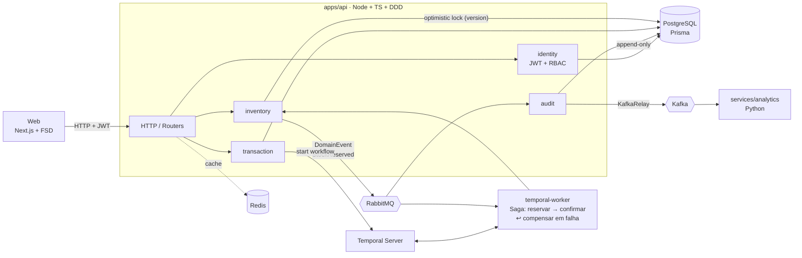
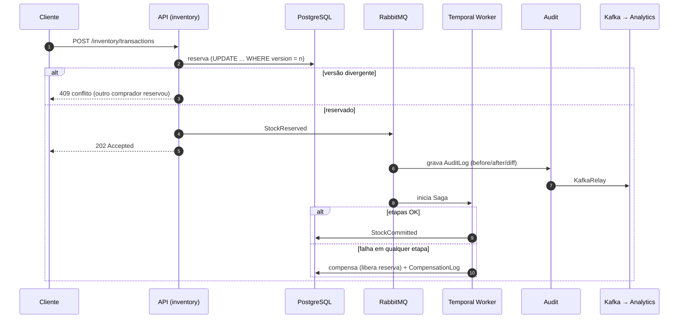

# iron-ledger

> Plataforma backend-first de **controle de estoque, auditoria imutável e transações distribuídas** (Saga), com DDD, arquitetura orientada a eventos e orquestração via Temporal.io.

<!-- DEMO_URL: adicionar aqui o link da demo quando houver deploy/vídeo -->
**Demo:** [roteiro da demonstração](./docs/flows/demo-presentation-flow.md) · **Decisões:** [ADRs](./docs/adr/) · **Arquitetura:** [docs/architecture](./docs/architecture/)

 

---

## O problema

Em ambientes onde estoque vale dinheiro, três coisas costumam dar errado ao mesmo tempo:

1. **Concorrência:** dois compradores reservam a última unidade (*overselling*).
2. **Falha parcial:** a reserva funciona, a confirmação externa falha, e o estado fica inconsistente.
3. **Rastreabilidade:** ninguém consegue provar quem mudou o quê e qual era o estado antes.

O iron-ledger ataca exatamente esses três pontos:

| Problema | Solução |
| --- | --- |
| Overselling | *Optimistic locking* com `version` em `StockLevel` |
| Falha parcial | Saga orquestrada no Temporal com **compensação automática** |
| Rastreabilidade | `AuditLog` **append-only** com `before` / `after` / `diff` |

## Arquitetura



### Fluxo principal



## Bounded contexts

| Contexto | Responsabilidade | Onde |
| --- | --- | --- |
| `inventory` | Estoque, movimentações, reservas | `apps/api/src/modules/inventory` |
| `transaction` | Transações distribuídas (Sagas) | `apps/api/src/modules/transaction`, `apps/temporal-worker` |
| `audit` | Registro imutável das mutações | `apps/api/src/modules/audit` |
| `identity` | Autenticação, JWT, RBAC | `apps/api/src/modules/identity` |
| `analytics` | Relatórios e alertas (Python) | `services/analytics` |

Cada módulo segue `domain / application / infra`: o domínio não conhece Prisma, Express nem brokers.

## Decisões arquiteturais

| ADR | Decisão |
| --- | --- |
| [ADR-001](./docs/adr/adr-001-temporal-vs-bullmq.md) | Temporal.io em vez de BullMQ para orquestração |
| [ADR-002](./docs/adr/adr-002-kafka-rabbitmq-split.md) | RabbitMQ para eventos de domínio, Kafka para o log de auditoria |
| [ADR-003](./docs/adr/adr-003-audit-append-only.md) | Auditoria como tabela append-only |
| [ADR-004](./docs/adr/adr-004-python-analytics-service.md) | Analytics em Python isolado via mensageria |

## Stack

**Backend:** Node.js, TypeScript, Express, Prisma, PostgreSQL, Redis, RabbitMQ, Kafka, Temporal.io, OpenTelemetry · **Analytics:** Python · **Frontend:** Next.js (App Router), Feature-Sliced Design, TanStack Query, Zustand, shadcn/ui + Tailwind · **Infra:** Docker Compose

## Status do projeto

Projeto acadêmico em equipe, em desenvolvimento. Estado honesto:

| Área | Estado |
| --- | --- |
| Modelagem de dados (Prisma: 15 modelos, locking otimista, `CompensationLog`, `AuditLog`) | Pronto |
| Estrutura DDD dos módulos, ADRs, roteiro de demo | Pronto |
| Implementação dos casos de uso, workflows Temporal, consumers | Em andamento |
| Docker Compose, serviço de analytics | Planejado |

## Como rodar

> O `docker-compose` ainda está em construção; os passos abaixo descrevem o fluxo-alvo.

```bash
git clone https://github.com/mariolucass/iron-ledger.git && cd iron-ledger
docker compose -f infra/compose/docker-compose.yml up -d   # Postgres, Redis, RabbitMQ, Kafka, Temporal
cd apps/api && pnpm install && pnpm prisma migrate dev && pnpm dev
cd apps/temporal-worker && pnpm dev                        # worker das Sagas
cd services/analytics && pip install -r requirements.txt && python main.py
```

Temporal UI em `http://localhost:8088`.

## Estrutura

```
apps/            api · web · temporal-worker
services/        analytics (Python)
packages/        shared-types · event-bus · logger
infra/           docker · compose
docs/            adr · architecture · flows
```

Detalhes em [`docs/architecture/directory-structure.md`](./docs/architecture/directory-structure.md).

## Licença

MIT
