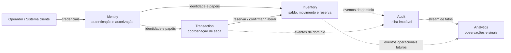
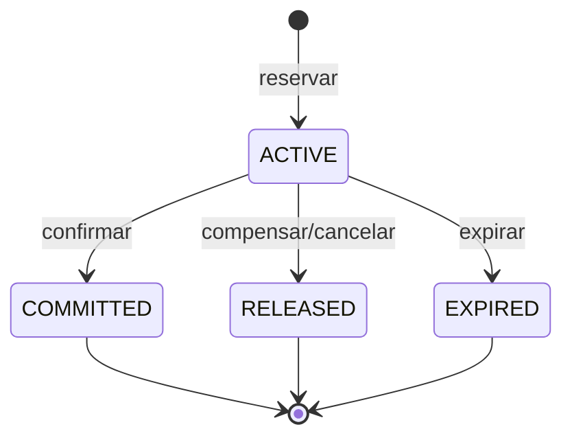
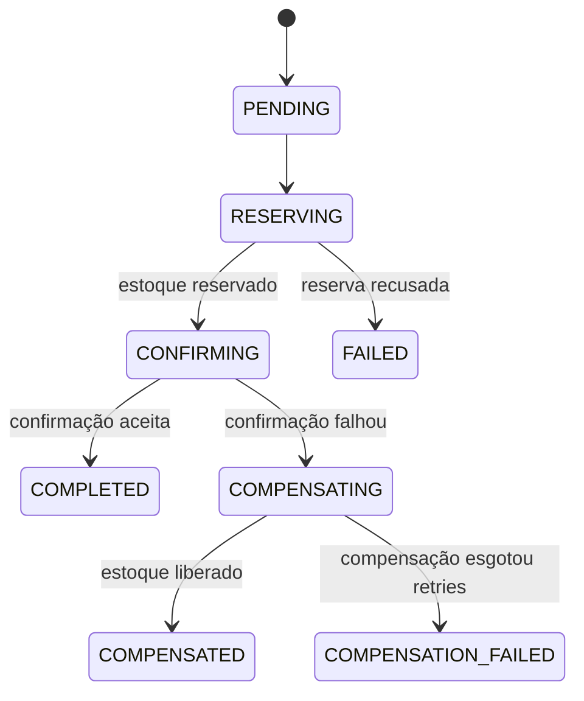

# Bounded contexts e modelo de domínio

Este documento descreve a decomposição de negócio do `iron-ledger`: qual módulo
é dono de cada conceito, quais invariantes protege e como os contextos podem se
comunicar. Ele não é apenas uma lista de pastas; é o contrato de autonomia do
sistema.

## 1. Por que DDD aqui

O sistema combina estoque, identidade, auditoria, transações distribuídas e
analytics. Esses assuntos usam palavras parecidas com significados diferentes.
Por exemplo, uma “transação” no contexto de orquestração não é uma transação SQL;
uma “reserva” não é uma saída definitiva de estoque; um “evento analítico” não é
fonte de verdade operacional.

Domain-Driven Design é usado para:

- manter regras de negócio fora de frameworks;
- atribuir dono inequívoco a dados e decisões;
- permitir evolução independente por contexto;
- tornar integrações explícitas por comandos, queries e eventos;
- impedir um modelo global que mistura responsabilidades incompatíveis.

DDD não significa criar uma classe para cada tabela. O modelo deve representar
comportamento, invariantes e linguagem do negócio.

## 2. Mapa de contextos



Linhas contínuas representam interação de comando/consulta; linhas tracejadas,
propagação assíncrona de fatos.

## 3. Matriz de ownership

| Conceito | Contexto dono | Fonte de verdade atual | Maturidade |
| --- | --- | --- | --- |
| usuário, credencial, papel | Identity | PostgreSQL/Prisma | IMPLEMENTADO para login; RBAC PARCIAL |
| produto, armazém, saldo | Inventory | PostgreSQL/Prisma | Schema IMPLEMENTADO; casos de uso PLANEJADOS |
| movimento e reserva | Inventory | PostgreSQL/Prisma | Schema IMPLEMENTADO; comportamento PLANEJADO |
| estado da transação/saga | Transaction | ainda não implementada | PLANEJADO |
| registro de auditoria | Audit | ainda não implementada | PLANEJADO |
| observação semanal Olist | Analytics | SQLite local | IMPLEMENTADO como laboratório |
| ponto de inflexão | Analytics | SQLite local | IMPLEMENTADO como laboratório |

Uma tabela existente não implica que o contexto esteja funcional. O schema de
Inventory existe, mas as operações de domínio e rotas correspondentes ainda são
scaffolds.

## 4. Identity

### Propósito

Responder “quem está fazendo a operação?” e “quais papéis/permissões essa
identidade possui?”. Identity autentica e autoriza; não decide regras de estoque.

### Linguagem

- **User**: identidade humana ou técnica registrada.
- **Role**: agrupamento nomeado de permissões.
- **Permission**: ação permitida sobre um recurso.
- **UserRole**: concessão de um papel a um usuário.
- **status**: `ACTIVE`, `INACTIVE` ou `SUSPENDED`.

### Modelo persistido

`User`, `Role`, `Permission`, `UserRole` e `RolePermission` estão no schema
Prisma. Exclusão lógica de usuário usa `deletedAt`.

### Invariantes

- e-mail é único e normalizado antes da busca;
- senha nunca é persistida em texto puro;
- apenas usuário `ACTIVE` e não excluído pode autenticar;
- token deve ser assinado pelo emissor `iron-ledger-api`;
- autorização deve usar permissões/papéis do contexto, não flags espalhadas.

### Fluxo implementado

`POST /auth/login` valida o payload, busca o usuário via porta
`LoginUserRepository`, compara bcrypt e emite JWT com `sub`, e-mail, nome e
papéis. `jwtGuard` valida Bearer token e anexa a identidade à request.

### Limites

O JWT atual carrega papéis no momento do login. Revogação de papel não invalida
um token já emitido até sua expiração. Para requisitos mais fortes serão
necessários tokens curtos, versionamento de sessão, denylist ou introspecção.

RBAC completo, refresh tokens, rotação de chave e gestão de usuários ainda não
estão implementados.

## 5. Inventory

### Propósito

Ser a autoridade sobre disponibilidade e histórico operacional de estoque por
produto e armazém.

### Linguagem

- **Product**: item identificado por SKU e unidade.
- **Warehouse**: local físico/lógico que mantém estoque.
- **StockLevel**: quantidade contábil e quantidade reservada do par
  produto/armazém.
- **StockMovement**: fato contábil que explica uma alteração de quantidade.
- **StockReservation**: bloqueio temporário associado a uma intenção de negócio.
- **Available quantity**: quantidade que pode ser prometida; conceitualmente
  `quantity - reserved`.

### Aggregate boundaries recomendados

O ponto de consistência forte é o saldo do par `(productId, warehouseId)`. Uma
operação de reserva deve atualizar o saldo reservado e criar a reserva na mesma
transação local. Um movimento deve registrar valores anterior e resultante junto
da alteração do saldo.

`Product` e `Warehouse` são referências para essa operação, não precisam compor
um aggregate gigante carregado integralmente.

### Invariantes

- não reservar mais do que a quantidade disponível;
- quantidades de comando devem ser positivas;
- saldo e reservado não podem ficar negativos;
- uma reserva só pode ser confirmada/liberada se estiver `ACTIVE`;
- o par produto/armazém possui um único `StockLevel`;
- todo ajuste de saldo deve produzir `StockMovement` rastreável;
- retry do mesmo comando não pode duplicar movimento ou reserva;
- atualização concorrente deve detectar conflito, usando `version` ou update
  condicional.

### Estados da reserva



Estados terminais não devem retornar a `ACTIVE`. Repetir a mesma transição deve
ser idempotente ou retornar o estado já alcançado.

### Eventos esperados

- `Inventory.StockReserved`
- `Inventory.StockReleased`
- `Inventory.StockCommitted`
- `Inventory.StockUpdated`
- `Inventory.StockReservationFailed`

O nome indica um fato no passado. Eventos não são comandos disfarçados.

### Estado atual

Schema, índices e enums estão implementados. As entidades, value objects,
repositórios, casos de uso e rotas ainda estão vazios. O endpoint
`POST /events/test` publica um envelope arbitrário no RabbitMQ para testar a
infraestrutura; ele não executa uma mutação real de Inventory.

## 6. Transaction

### Propósito

Coordenar operações distribuídas que não cabem em uma transação ACID única. Seu
trabalho é manter o estado da intenção, chamar participantes e compensar efeitos
quando um passo posterior falha.

### O que não é

- não é uma abstração sobre `BEGIN/COMMIT` do PostgreSQL;
- não é dona do saldo de estoque;
- não reimplementa regras de Inventory;
- não garante atomicidade instantânea entre serviços.

### Linguagem esperada

- **Transaction**: intenção de negócio correlacionada por ID.
- **Saga**: sequência durável de passos e compensações.
- **Step**: atividade com resultado registrado.
- **Compensation**: ação semântica que desfaz ou neutraliza efeito anterior.
- **Workflow ID**: identidade idempotente da execução Temporal.

### Invariantes

- iniciar duas vezes a mesma transação não cria duas sagas;
- apenas passo concluído pode precisar de compensação;
- compensações devem ser idempotentes;
- estado terminal não retrocede;
- falha técnica temporária gera retry; falha de negócio conduz a rejeição ou
  compensação;
- todo passo carrega `transactionId`/correlation ID.

### Saga-alvo



Temporal persiste o histórico do workflow. Activities realizam I/O e devem usar
timeouts, retry policy e chaves idempotentes explícitas.

### Estado atual

**PLANEJADO**. Pastas e dependências Temporal existem, e o Compose sobe Temporal
Server/UI, porém workflow, activities, starter e persistência de Transaction
estão vazios.

## 7. Audit

### Propósito

Responder de forma confiável: quem fez o quê, quando, sobre qual agregado, com
qual resultado e correlação? Audit é leitura histórica e evidência; não comanda
outros contextos.

### Modelo recomendado

Um registro mínimo deve conter:

- `auditId` e `eventId` únicos;
- `eventName` e versão do schema;
- `occurredAt` do produtor e `recordedAt` do auditor;
- `aggregateType` e `aggregateId`;
- `actorId` quando houver usuário;
- `correlationId` e `causationId`;
- payload e metadados serializados;
- origem/serviço produtor.

### Invariantes

- append-only: não atualizar nem excluir registros operacionais;
- `eventId` único para deduplicação;
- payload registrado deve ser sanitizado: senha, token e segredo nunca entram;
- evento recebido novamente não cria segunda linha;
- auditoria indisponível não pode corromper a transação do produtor.

Imutabilidade de aplicação não basta para requisito regulatório. Em produção,
permissões do banco, retenção, backup, criptografia e eventualmente armazenamento
WORM devem reforçar a política.

### Estado atual

**PLANEJADO**. O módulo e o cliente Kafka são scaffolds. Não há tabela de audit
no Prisma nem consumidor ativo.

## 8. Analytics

### Propósito

Transformar dados históricos e streams futuros em observações, relatórios e
sinais explicáveis. Analytics não altera estoque nem decide uma transação.

### Linguagem atual

- **Observation**: métricas agregadas de uma entidade em um período.
- **Inflection point**: mudança persistente de patamar detectada por regra.
- **Evidence**: janelas e valores usados para explicar o sinal.
- **Confidence**: índice heurístico de força e suporte; não probabilidade.
- **Source**: origem do dado, hoje `OLIST`.

### Pipeline implementado

1. carrega CSVs Olist em tabelas staging;
2. agrega observações semanais por vendedor/categoria;
3. aplica detector baseado em mediana, MAD e janela persistente;
4. persiste pontos de inflexão idempotentes em SQLite;
5. gera relatório de qualidade;
6. expõe summary e consultas via FastAPI.

O detector avalia pedidos, unidades, receita, cancelamento, indisponibilidade,
atraso, prazo de entrega e review. Evidência e limitações são persistidas para
evitar apresentar correlação observacional como causalidade.

### Invariantes

- reprocessar a mesma fonte produz IDs estáveis e substitui resultados Olist;
- dado ausente não é automaticamente zero, exceto nas métricas configuradas;
- primeiro movimento após baseline zerado é ativação, não inflexão operacional;
- sinal precisa superar limiar absoluto e escala robusta;
- fonte analítica nunca é a fonte de verdade do saldo operacional.

### Evolução planejada

Consumir Kafka, persistir em storage adequado a concorrência/volume e publicar
`Analytics.InflectionPointDetected`. Essa evolução exige checkpoint do consumer,
deduplicação e contrato versionado.

## 9. Relações entre contextos

### Identity → demais contextos

Relação de **fornecedor**: Identity fornece identidade autenticada e claims. O
consumidor deve traduzir claims para sua política local. Inventory não deve
consultar tabelas de senha ou implementar autenticação.

### Transaction → Inventory

Relação cliente/fornecedor. Transaction pede uma capacidade (`reserve`,
`commit`, `release`); Inventory decide se a regra pode ser satisfeita. A saga
armazena a resposta e não manipula tabelas de estoque diretamente.

### Domínios operacionais → Audit

Relação assíncrona downstream. Audit conforma eventos de diferentes produtores
em seu modelo append-only. O produtor não conhece tabelas internas de Audit.

### Audit/Inventory → Analytics

Relação downstream e eventualmente conformist/ACL. Analytics traduz eventos
operacionais para seu modelo de observação. Mudanças no modelo analítico não
devem voltar para alterar o significado dos eventos operacionais.

## 10. Comunicação: qual mecanismo usar

| Necessidade | Mecanismo | Motivo |
| --- | --- | --- |
| resposta imediata ao usuário | HTTP síncrono | feedback e validação direta |
| evento de domínio entre consumidores operacionais | RabbitMQ | roteamento e entrega de trabalho |
| stream durável/reprocessável | Kafka | retenção e múltiplos consumidores |
| operação longa com compensação | Temporal | estado e retries duráveis |
| consistência dentro do contexto | transação PostgreSQL | atomicidade local |
| cache/coordenação efêmera | Redis | baixa latência, nunca fonte primária |

Usar mais de uma tecnologia só se justifica quando as semânticas são distintas.
Não publique o mesmo evento de forma independente em RabbitMQ, Kafka e banco
sem um padrão de outbox/relay, pois isso cria dual write inconsistente.

## 11. Consistência e ownership de dados

O modelo-alvo usa consistência forte dentro de um contexto e consistência
eventual entre contextos.

```text
Transação local: saldo + movimento + outbox = atômicos
Entrega assíncrona: pelo menos uma vez
Consumidor: idempotente por eventId
Projeção downstream: eventualmente consistente
```

Hoje Identity e o schema de Inventory compartilham o mesmo PostgreSQL por
praticidade do estágio modular-monolith. Isso não concede acesso irrestrito:
repositórios de um contexto não devem escrever tabelas de outro. Separar schema
ou banco no futuro será uma decisão operacional, não uma reescrita do domínio.

## 12. Eventos de domínio

Envelope recomendado:

```json
{
  "eventId": "uuid",
  "eventName": "Inventory.StockReserved",
  "eventVersion": 1,
  "occurredAt": "2026-09-22T12:00:00.000Z",
  "producer": "iron-ledger-api",
  "aggregateId": "uuid",
  "correlationId": "uuid",
  "causationId": "uuid-ou-null",
  "actorId": "uuid-ou-null",
  "payload": {}
}
```

Regras:

- `eventId` identifica a ocorrência, não o agregado;
- `eventName` representa fato no passado e é estável;
- `eventVersion` muda quando compatibilidade semântica quebra;
- `occurredAt` vem do produtor; consumidor registra também a hora de recepção;
- payload contém dados suficientes para o consumidor, sem expor segredos;
- chaves de correlação atravessam HTTP, broker, workflow e logs.

O envelope do endpoint de teste atual é menor que esse contrato-alvo. Ele é uma
sonda de infraestrutura, não deve ser cristalizado como contrato definitivo.

## 13. Padrões táticos esperados

### Entity

Possui identidade e ciclo de vida. Igualdade por ID, não por todos os atributos.

### Value Object

É imutável, validado na construção e comparado por valor. Exemplos: `Sku`,
`Quantity`, `Email`.

### Aggregate

Fronteira de consistência. Alterações passam pela raiz, que protege invariantes.
Aggregate não é sinônimo de árvore completa de tabelas.

### Repository

Porta orientada ao domínio. Deve oferecer intenções (`saveReservation`,
`findAvailableStock`), não expor o Prisma cru para a camada de aplicação.

### Use case

Orquestra uma intenção: valida autorização contextual, carrega aggregate, invoca
comportamento, persiste e produz resultado/eventos. Não contém detalhes HTTP.

### Domain event

Registra algo relevante que já ocorreu no domínio. Deve ser criado junto da
mudança que representa e publicado de modo confiável.

## 14. O que o projeto é hoje e para onde vai

Hoje o projeto é um **modular monolith em construção**, acompanhado de um
serviço analítico isolado e infraestrutura para evolução event-driven. A API
executável oferece autenticação, healthcheck e publicação de evento de teste.

Arquitetura-alvo:

1. completar Inventory como primeiro domínio operacional;
2. introduzir outbox transacional e consumidores idempotentes;
3. completar Audit antes de prometer rastreabilidade total;
4. implementar Transaction e worker Temporal com activities reais;
5. conectar Kafka ao pipeline de Analytics;
6. implementar Web sobre contratos HTTP estáveis;
7. ativar tracing e logs correlacionados.

Essa sequência reduz risco: primeiro consolida a fonte de verdade, depois
propaga eventos, depois coordena processos longos e por último amplia projeções.

## 15. Perguntas obrigatórias em code review

- Qual contexto é dono desta regra e deste dado?
- A mudança preserva as invariantes do aggregate?
- Há dependência de framework vazando para domínio/aplicação?
- O caminho síncrono precisa mesmo esperar este efeito?
- Se a mensagem for entregue duas vezes, o resultado continua correto?
- Se publicar falhar depois do commit, o evento será recuperado?
- O contrato é retrocompatível para consumidores existentes?
- Há correlação e evidência suficientes para investigar uma falha?
- A documentação distingue o que está pronto do que está planejado?
