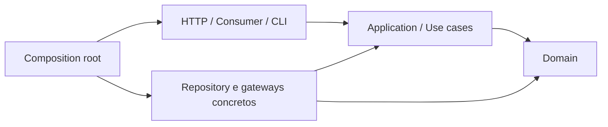
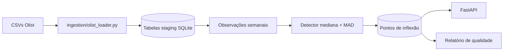

# Estrutura do repositório

Este documento explica onde cada responsabilidade vive, como navegar pelo
monorepo e onde adicionar código novo sem degradar os limites arquiteturais.
Ele deve ser lido antes de alterar a organização de pastas.

> Estado da documentação: setembro de 2026. Nem toda pasta representa uma
> funcionalidade pronta. Consulte os marcadores de maturidade abaixo.

## 1. Leitura rápida

O `iron-ledger` é um monorepo com quatro grupos principais:

| Área | Papel | Tecnologia principal |
| --- | --- | --- |
| `apps/` | Aplicações implantáveis mantidas em TypeScript | Node.js, Express, Next.js, Temporal |
| `services/` | Serviços implantáveis fora do runtime Node.js | Python, FastAPI, SQLite |
| `packages/` | Contratos e bibliotecas compartilhadas | TypeScript |
| `infra/` | Empacotamento e composição do ambiente | Docker, Docker Compose |
| `docs/` | Decisões, fluxos e modelo arquitetural | Markdown, Mermaid |

Regra prática:

- se possui processo, porta, healthcheck ou ciclo de deploy próprio, pertence a
  `apps/` ou `services/`;
- se é importado por mais de uma aplicação e não inicia processo próprio,
  pertence a `packages/`;
- se descreve como executar, conectar ou publicar os processos, pertence a
  `infra/`;
- regra de negócio nunca deve nascer em `infra/` nem em controller HTTP.

## 2. Marcadores de maturidade

Os documentos de arquitetura usam estes três estados:

- **IMPLEMENTADO**: há código executável e integrado ao caminho principal;
- **PARCIAL**: existem contratos, schema, infraestrutura ou experimento, mas o
  fluxo completo ainda não está conectado;
- **PLANEJADO**: a estrutura expressa a direção arquitetural, porém ainda não
  entrega comportamento em runtime.

Essa distinção é essencial neste projeto. Uma pasta vazia não é uma
implementação; ela é, no máximo, uma reserva explícita de responsabilidade.

## 3. Árvore comentada

```text
iron-ledger/
├── apps/
│   ├── api/                       # API principal e módulos de domínio
│   │   ├── prisma/                # Modelo relacional, migrações e seed
│   │   └── src/
│   │       ├── config/            # Validação de configuração de runtime
│   │       ├── infra/             # Adaptadores técnicos da aplicação
│   │       │   ├── cache/
│   │       │   ├── database/
│   │       │   ├── http/
│   │       │   ├── messaging/
│   │       │   └── telemetry/
│   │       ├── modules/           # Bounded contexts dentro da API
│   │       │   ├── audit/
│   │       │   ├── identity/
│   │       │   ├── inventory/
│   │       │   └── transaction/
│   │       ├── shared/            # Kernel técnico interno da API
│   │       └── main.ts            # Composition root / bootstrap
│   ├── web/                       # Interface Next.js (planejada)
│   └── temporal-worker/           # Worker de sagas (planejado)
├── services/
│   └── analytics/                 # Laboratório analítico Python
│       ├── data/                  # Entradas e banco local; não versionados
│       ├── reports/               # Relatórios produzidos pelo pipeline
│       ├── src/
│       │   ├── api/               # API de consulta FastAPI
│       │   ├── consumers/         # Entrada Kafka futura
│       │   ├── detectors/         # Detecção de pontos de inflexão
│       │   ├── ingestion/         # Leitura e normalização da Olist
│       │   ├── processors/        # Processamentos futuros
│       │   ├── pipeline.py        # Orquestração do pipeline batch
│       │   ├── repository.py      # Consultas sobre resultados
│       │   └── storage.py         # Schema e conexão SQLite
│       └── tests/
├── packages/
│   ├── event-bus/                 # Abstrações de publicação (planejadas)
│   ├── logger/                    # Logging compartilhado (planejado)
│   └── shared-types/              # Eventos e DTOs entre processos
├── infra/
│   ├── compose/                   # Overrides por ambiente
│   └── docker/                    # Dockerfiles multi-stage por aplicação
├── docs/
│   ├── adr/                       # Decisões arquiteturais imutáveis
│   ├── analytics/                 # Guias específicos de analytics
│   ├── architecture/              # Modelo arquitetural atual
│   └── flows/                     # Detalhamento de casos de uso
├── docker-compose.yml             # Entrada principal do ambiente local
├── package.json                   # Scripts do workspace
├── pnpm-lock.yaml                 # Resolução reproduzível de dependências
└── pnpm-workspace.yaml            # Fronteiras do monorepo pnpm
```

## 4. `apps/api`: aplicação principal

### 4.1 Composition root

`apps/api/src/main.ts` é o ponto em que dependências concretas são criadas e o
processo é iniciado. Hoje ele:

1. carrega e valida variáveis de ambiente;
2. conecta o Prisma ao PostgreSQL;
3. conecta o cliente RabbitMQ;
4. monta o servidor HTTP;
5. registra encerramento gracioso para `SIGINT` e `SIGTERM`.

Esse arquivo pode conhecer implementações concretas. Casos de uso não podem.
Quando Redis, Kafka, consumidores ou telemetria forem conectados, a composição
deve continuar centralizada aqui ou em módulos de bootstrap chamados por ele.

### 4.2 `config/`

Contém a fronteira de configuração. `env.ts` usa Zod para falhar cedo se uma
variável obrigatória estiver ausente ou inválida. Código interno deve consumir o
objeto `env`, evitando leituras dispersas de `process.env`.

Ao adicionar uma variável:

1. declare e valide em `config/env.ts`;
2. atualize `apps/api/.env.example`;
3. atualize o ambiente do serviço no Compose;
4. documente impacto operacional quando houver.

### 4.3 `infra/`

`infra` dentro da API significa **adaptadores da aplicação**, não infraestrutura
de deploy. É onde moram detalhes substituíveis:

| Pasta | Responsabilidade | Estado |
| --- | --- | --- |
| `database/` | Cliente Prisma e acesso ao PostgreSQL | IMPLEMENTADO |
| `http/` | Express, rotas, middlewares e servidor | IMPLEMENTADO |
| `messaging/` | Clientes RabbitMQ e Kafka | RabbitMQ IMPLEMENTADO; Kafka PLANEJADO |
| `cache/` | Cliente Redis | PLANEJADO |
| `telemetry/` | Inicialização OpenTelemetry | PLANEJADO |

Um adaptador pode importar SDKs e frameworks. O domínio não deve importar
Prisma, Express, RabbitMQ, Kafka ou Temporal.

### 4.4 `modules/`

Cada diretório abaixo de `modules/` representa um bounded context ou módulo de
negócio. A estrutura desejada dentro de um módulo é:

```text
module/
├── domain/
│   ├── entities/          # Identidade e ciclo de vida
│   ├── value-objects/     # Valores imutáveis e validados
│   ├── events/            # Fatos de domínio ocorridos
│   ├── repositories/      # Portas exigidas pelo domínio/aplicação
│   └── services/          # Regra que não pertence a uma entidade
├── application/
│   ├── dtos/              # Entrada e saída do caso de uso
│   └── use-cases/         # Orquestração de uma intenção do usuário
└── infra/
    ├── consumers/         # Adaptadores de entrada assíncrona
    ├── http/              # Controllers e rotas
    ├── repositories/      # Implementações das portas
    └── temporal/          # Integração com workflows, quando aplicável
```

Direção permitida das dependências:



A seta significa “conhece/importa”. O domínio fica no centro e não conhece as
camadas externas.

### 4.5 `shared/`

`apps/api/src/shared` deve conter apenas primitivas realmente comuns à API:
erros base, paginação, `Result`, classes base de entidade e evento. Ele não deve
virar uma pasta de conveniência com regras de vários domínios.

Critério: se um conceito usa linguagem de `inventory`, ele pertence a
`modules/inventory`, mesmo que outro módulo queira consumi-lo. O compartilhamento
deve acontecer por contrato explícito, não movendo o domínio para `shared`.

### 4.6 Persistência Prisma

`apps/api/prisma/schema.prisma` contém o generator e o datasource. O modelo
relacional da API está dividido em arquivos `.prisma` na mesma pasta:

- `identity.prisma`: usuários, papéis, permissões e associações;
- `audit.prisma`: logs de auditoria;
- `catalog.prisma`: produtos;
- `warehouses.prisma`: armazéns;
- `inventory.prisma`: saldos, movimentos e reservas de estoque.

O Prisma 5.22 usa `prismaSchemaFolder` e o caminho `prisma` em
`apps/api/package.json` para carregar todos esses arquivos. As migrações em
`prisma/migrations/` são histórico versionado. Não edite uma migração já
aplicada em ambiente compartilhado; crie outra. O `seed.ts` existe para dados
locais reproduzíveis, não para corrigir dados de produção.

## 5. `apps/web`

Arquitetura pretendida: Next.js App Router com Feature-Sliced Design.

```text
src/
├── app/                    # Rotas, layouts e composição de páginas
├── features/               # Capacidades do usuário, por exemplo audit-log
└── shared/
    ├── lib/                # Cliente HTTP, query client e utilidades
    └── types/              # Tipos exclusivos da aplicação web
```

Estado atual: **PLANEJADO**. Os arquivos estão vazios. O Dockerfile está pronto
para os estágios de desenvolvimento e produção, mas o serviço não entra no
Compose até existir uma aplicação compilável.

Quando implementado, `app/` não deve concentrar regra de negócio. Uma página
compõe features; cada feature contém acesso à API, estado e componentes próprios.

## 6. `apps/temporal-worker`

O worker será um processo separado da API porque possui ciclo de escala, falha
e deploy diferente. A estrutura reservada distingue:

- `workflows/`: orquestração determinística e durável;
- `activities/`: efeitos externos, como reservar estoque ou confirmar uma
  transação;
- `worker.ts`: conexão, registro de workflows/activities e polling da task queue.

Estado atual: **PLANEJADO**. Os arquivos estão vazios. A infraestrutura Temporal
pode ser iniciada pelo perfil `platform`, mas ainda não há worker funcional.

Regra crítica do Temporal: workflow deve ser determinístico; acesso a banco,
HTTP, relógio não determinístico e mensageria pertence a activities.

## 7. `services/analytics`

É um serviço Python isolado para não acoplar processamento analítico ao caminho
transacional. Hoje funciona como laboratório batch sobre dados da Olist:



Separação interna:

- `pipeline.py` coordena, mas não implementa os algoritmos;
- `ingestion/` entende o formato da fonte;
- `detectors/` contém a regra analítica;
- `storage.py` mantém o schema local;
- `repository.py` oferece consultas;
- `api/server.py` traduz HTTP para chamadas ao repositório;
- `reporting/` apresenta qualidade e limitações.

O consumidor Kafka ainda é **PLANEJADO**. O SQLite atual é adequado ao
laboratório local, não é a persistência-alvo para ingestão concorrente em escala.

## 8. `packages`

### `shared-types`

Contém contratos serializáveis entre processos, incluindo eventos e DTOs de
analytics. Deve conter tipos, schemas de validação e constantes de protocolo;
jamais clientes de banco, lógica de negócio ou dependências de framework.

Compatibilidade importa: alterar um campo obrigatório de evento é uma mudança de
contrato. Prefira evolução aditiva e versione eventos quando a semântica mudar.

### `event-bus`

Reserva a porta comum de publicação e implementações por transporte. Estado
atual: **PLANEJADO**. A API usa diretamente `RabbitMqClient`; migrar para essa
abstração deve ocorrer quando houver um segundo produtor ou necessidade real de
test doubles consistentes.

### `logger`

Reserva o logger estruturado e a correlação de telemetria. Estado atual:
**PLANEJADO**.

## 9. `infra`

Há dois níveis:

- `docker/`: como cada aplicação vira uma imagem;
- `compose/`: como a composição muda entre desenvolvimento e produção.

O `docker-compose.yml` da raiz é a entrada local e separa serviços opcionais por
perfil. `api-setup` executa migrações e seed antes da API, evitando que cada
réplica concorra para migrar o banco.

| Perfil | Serviços adicionais | Uso |
| --- | --- | --- |
| padrão | PostgreSQL, RabbitMQ, Redis, API | desenvolvimento diário |
| `platform` | Kafka, Temporal, Temporal UI | integração assíncrona e sagas |
| `analytics` | API Python | laboratório analítico |
| `observability` | Jaeger/OTLP | inspeção de traces |

O Compose é ambiente local e referência operacional. Alta disponibilidade real
exige orquestrador, secrets manager, backups, múltiplos brokers/nós e políticas
de autoscaling; não se deve chamar um Compose de produção distribuída.

## 10. `docs`

- `architecture/`: descreve o sistema vigente e sua direção;
- `adr/`: registra uma decisão, alternativas e consequências;
- `flows/`: aprofunda um caso de uso ou sequência;
- `analytics/`: operação e limitações do experimento analítico.

No estado atual, os arquivos de `adr/` e `flows/` são placeholders vazios. Os
nomes indicam a documentação prevista, mas não devem ser citados como decisões
já detalhadas até receberem conteúdo e status explícito.

Um ADR não deve ser reescrito para esconder uma decisão antiga. Se a decisão
mudar, marque o ADR anterior como substituído e crie outro.

## 11. Onde colocar código novo

| Necessidade | Local recomendado |
| --- | --- |
| Nova regra de estoque | `apps/api/src/modules/inventory/domain` |
| Novo comando/caso de uso | `modules/<context>/application/use-cases` |
| Nova rota | `modules/<context>/infra/http` e composição no router |
| Query Prisma concreta | `modules/<context>/infra/repositories` |
| Evento entre processos | `packages/shared-types/src/events` |
| Activity Temporal | `apps/temporal-worker/src/activities` |
| Workflow Temporal | `apps/temporal-worker/src/workflows` |
| Algoritmo analítico | `services/analytics/src/detectors` ou `processors` |
| Configuração de container | `infra/docker` ou `infra/compose` |
| Decisão estrutural nova | `docs/adr` |

## 12. Checklist para criar um módulo

1. Defina a linguagem e invariantes do contexto.
2. Modele entidades e value objects sem framework.
3. Declare portas de repositório/gateway próximas ao consumidor.
4. Implemente um caso de uso com entrada e saída explícitas.
5. Crie adaptadores concretos na camada `infra`.
6. Faça a composição no bootstrap/router.
7. Adicione migração se houver persistência.
8. Teste domínio e caso de uso sem infraestrutura sempre que possível.
9. Documente eventos, consistência e falhas.
10. Atualize o status arquitetural deste diretório.

## 13. Anti-padrões a evitar

- controller acessando Prisma diretamente;
- entidade importando Express ou Prisma;
- módulo lendo tabela interna de outro contexto como atalho permanente;
- evento sem `eventId`, instante e versão/semântica conhecida;
- `shared/` usado como depósito de código sem dono;
- workflow Temporal realizando I/O diretamente;
- consumidor assumindo entrega exatamente uma vez;
- migração de banco executada por cada réplica da API;
- documentação descrevendo como pronto aquilo que é apenas scaffold.

## 14. Roteiro de leitura para onboarding

1. [`README.md`](../../README.md): proposta e execução local.
2. Este documento: mapa físico e regras de organização.
3. [`bounded-contexts.md`](./bounded-contexts.md): mapa de negócio e limites.
4. [`event-flow.md`](./event-flow.md): comunicação e consistência.
5. `apps/api/src/main.ts`, `infra/http/router.ts` e os `modules/*/<módulo>.module.ts`: caminho executável atual.
6. `apps/api/prisma/schema.prisma`: modelo persistido atual.
7. `services/analytics/src/pipeline.py`: segundo processo já funcional.
8. ADRs e fluxos específicos quando forem preenchidos; até lá, use estes três
   documentos e valide decisões novas em code review.
