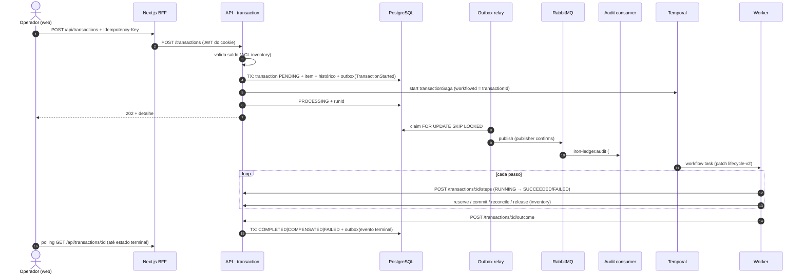

# Plano de arquitetura — iron-ledger

> **Data:** 18/10/2026 · **Escopo:** API, temporal-worker, web, pacotes compartilhados e serviço de analytics.
> Complementa [`bounded-contexts.md`](./bounded-contexts.md), [`event-flow.md`](./event-flow.md) e
> [`frontend-fsd-proposal.md`](./frontend-fsd-proposal.md). As decisões marcadas como **ADR** devem virar
> registros em [`docs/adr/`](../adr/); os quatro ADRs atuais ainda estão vazios.

## 1. Resumo

O primeiro fluxo ponta a ponta foi implementado e testado em todas as camadas: a **transação de saída
orquestrada por Saga**. Ele serve de referência para os próximos contextos. Cada serviço que ainda não tem
arquitetura definida deve copiar esse desenho, não reinventá-lo.

| Peça | Situação | Arquitetura recomendada |
| --- | --- | --- |
| `apps/api` | Contextos `transaction`, `inventory`, `audit` e `identity` funcionais; `shared/domain`, Redis, Kafka e OTel vazios | **Monólito modular** com DDD tático + hexagonal + CQRS leve por bounded context |
| `apps/temporal-worker` | Hexagonal, com testes de replay | **Worker por domínio**, com portas HTTP para a API e versionamento por `patched()` |
| `apps/web` | FSD; inventário, auditoria e transações ligados à API; alertas, previsão, relatórios, usuários e configurações ainda simulados | **FSD + BFF** no Next.js, com estado de servidor em TanStack Query |
| `packages/*` | `shared-types`, `logger` e `event-bus` implementados e compilados para `dist/` | **Kernel compartilhado** sem regra de negócio, apenas contratos e infraestrutura |
| `services/analytics` | Pipeline Olist batch + API HTTP | **Serviço isolado** (ADR-004) que consome eventos e escreve apenas no schema `analytics` |

## 2. Fluxo de referência implementado



O que cada camada entrega e onde está:

| Camada | Entrega | Local |
| --- | --- | --- |
| Contratos | DTOs HTTP e envelope de evento (`eventVersion`, `producer`, `correlationId`, `causationId`) | `packages/shared-types` |
| Contratos worker↔API | `RecordSagaStepInput`, `TransactionOutcome`, `TransactionSagaInput.correlationId` | `packages/workflow-contracts` |
| Logs | JSON (pino), contexto por `AsyncLocalStorage`, redação de credenciais | `packages/logger` |
| Mensageria | RabbitMQ com publisher confirms, retry com contador, fila `<queue>.dead-letter`, implementação em memória | `packages/event-bus` |
| Domínio | Agregado `Transaction` com máquina de estados e eventos de domínio | `apps/api/src/modules/transaction/domain` |
| Aplicação | Iniciar, consultar, registrar passo e reportar desfecho; retry em conflito de versão | `.../transaction/application` |
| Infra | Repositório Prisma (escrita + read model), ACL de saldo, adaptador Temporal com conexão única | `.../transaction/infra` |
| Consistência | Outbox transacional + relay concorrente seguro (`SKIP LOCKED`, backoff, `DEAD_LETTER`) | `apps/api/src/infra/outbox` |
| Orquestração | Saga rastreada sob `patched("transaction-saga-lifecycle-v2")`; histories v0/v1 continuam reproduzíveis | `apps/temporal-worker/src/modules/transaction` |
| Interface | Lista com filtros, paginação e polling; detalhe com linha do tempo, compensação e histórico; feature "Nova transação" | `apps/web/src/{entities,features,views}` |

**Testes:** pacotes 6/6, API 28/28 (15 novos), worker 22/22 unitários e 9/9 de integração Temporal (incluindo
replay), web dentro da linha de base. **Não validado** contra PostgreSQL, RabbitMQ e Temporal reais, porque
o ambiente de desenvolvimento usado não tinha Docker. Validar com `docs/temporal/saga-demo.md` antes de
considerar o fluxo pronto.

## 3. Arquitetura por serviço

### 3.1 API — monólito modular orientado a bounded contexts

**Por quê:** um único deploy mantém as transações ACID locais (saldo + movimento + outbox no mesmo commit)
e evita a complexidade operacional de microsserviços antes de haver escala que a justifique. As fronteiras
de DDD ficam explícitas no código e no banco (um schema PostgreSQL por contexto), o que permite extrair um
contexto para outro serviço depois sem reescrever.

Estrutura obrigatória de cada módulo, igual à de `transaction`:

```text
modules/<contexto>/
├── domain/          entidades/agregados, value objects, eventos, portas de repositório (sem Prisma, sem Express)
├── application/     casos de uso, portas de saída (ports/), DTOs de comando
└── infra/           http (controller, routes, schemas zod), repositories (Prisma), adaptadores externos, consumers
```

Regras:

1. **Dependência para dentro:** `infra → application → domain`. O domínio não importa Prisma, Express nem SDKs.
2. **Comunicação entre contextos:** por evento (assíncrono) ou por uma porta ACL de leitura (síncrono, como
   `StockAvailabilityPort`). Um contexto nunca escreve nas tabelas de outro.
3. **Eventos sempre via outbox.** A publicação direta pós-commit é proibida em código novo.
4. **CQRS leve:** a porta de escrita trabalha com o agregado e a porta de leitura devolve DTOs prontos.
   Read models dedicados (views materializadas) só quando a consulta provar necessidade.
5. **Concorrência otimista** (`version`) em todo agregado mutável, com retry curto no caso de uso.
6. **Composition root** único em `infra/http/router.ts` + `main.ts`. Avaliar um container de DI leve
   (ex.: `awilix`) quando o arquivo passar de cerca de 200 linhas.

Pendências por contexto:

| Contexto | Pendência | Prioridade |
| --- | --- | --- |
| `inventory` | Migrar `UpdateStock/Reserve/Release/Commit` da publicação pós-commit para o outbox (mesma TX do saldo) | **Alta** |
| `inventory` | Expiração de reservas (`expiresAt`) com job agendado (Temporal Schedule) e evento `StockReservationExpired` | Média |
| `inventory` | Lotes, endereçamento, transferências e contagens (tabelas já existem) | Média |
| `identity` | RBAC por permissão (`identity.permissions`), papel `SERVICE` e usuário dedicado do worker, refresh token rotativo, lockout | **Alta** |
| `audit` | Cadeia de hash (`hash`/`previousHash`), trigger que bloqueia UPDATE/DELETE, particionamento mensal (ADR-003) | Alta |
| `catalog` / `warehouse` | CRUD com eventos (`Catalog.ProductCreated`…) para alimentar analytics | Média |
| `transaction` | Reconciliação periódica: transações em `PROCESSING` cujo workflow terminou sem reportar desfecho | Alta |
| `platform` | Inbox (`platform.inbox_messages`) nos consumidores, idempotência HTTP genérica (`platform.idempotency_keys`), configurações e feature flags | Média |
| `shared/domain` | Arquivos vazios (`entity`, `aggregate-root`, `value-object`, `domain-event`): implementar a partir do padrão de `Transaction` ou remover | Baixa |

### 3.2 temporal-worker — worker hexagonal por domínio

O desenho atual (portas em `ports/`, adaptadores HTTP em `infrastructure/`, orquestração pura em
`modules/*/workflows/run-*.ts`) é o padrão. Regras:

1. **Workflow sem I/O.** A orquestração é uma função pura testável sem Temporal. O arquivo `*.workflow.ts`
   só faz `proxyActivities`, aplica `patched()` e define o runtime.
2. **Versionamento:** toda mudança na sequência de comandos entra em `patched("<nome>-vN")`. Nunca renomear
   nem remover um patch enquanto existirem histories antigas. Para cada versão, guardar um snapshot em
   `tests/replay/` e um teste de replay.
3. **Activities chamam a API**, nunca o banco. O dono dos dados continua sendo o contexto da API, e o
   worker é escalável e substituível.
4. **Uma task queue por domínio** quando surgirem novos workflows (`inventory-tasks`, `transaction-tasks`),
   com workers dimensionados separadamente.
5. **Identidade de serviço:** substituir o login com o usuário do seed por uma API key do papel `SERVICE`
   (tabelas `identity.api_keys` e `identity.api_key_permissions`) ou mTLS.

Próximos workflows candidatos: `stockTransferSaga` (reserva na origem, expedição, recebimento no destino),
`stockCountWorkflow` (contagem cega, revisão, ajuste) e `reservationExpiry` (Temporal Schedule).

### 3.3 web — Feature-Sliced Design + BFF

O BFF do Next.js mantém o token em cookie HTTP-only e é a única via de acesso à API. Regras:

1. **Camadas:** `app → views → widgets → features → entities → shared`, importando apenas pelo `index.ts`
   de cada slice.
2. **Tipos vêm de `@iron-ledger/shared-types`.** As entities reexportam os DTOs, como a entity
   `transaction` já faz, em vez de redefinir o contrato.
3. **Estado de servidor:** adotar **TanStack Query** (citado no README, ainda não instalado) para substituir
   o padrão manual `useEffect + useState + usePolling`. Ganhos: cache, deduplicação, `refetchInterval`
   condicional, invalidação após mutações.
4. **Estado de URL:** adotar **nuqs** para filtros (status, datas, página) e torná-los compartilháveis.
5. **Telas ainda simuladas:** alertas, previsão, relatórios, usuários e configurações. Cada uma deve ser
   ligada somente quando o endpoint correspondente existir, sem criar clientes para APIs inexistentes.
6. **Pendência estrutural:** o teste `tests/fsd-boundaries.test.ts` espera a camada `_pages`, enquanto o
   código usa `views/`. Já falhava antes deste trabalho. Decidir o nome e alinhar teste, README e
   diretório.

### 3.4 Pacotes compartilhados — kernel técnico

| Pacote | Responsabilidade | Não pode conter |
| --- | --- | --- |
| `shared-types` | DTOs HTTP públicos e envelopes/payloads de eventos | regras de negócio, dependências de runtime |
| `workflow-contracts` | Tipos da fronteira worker↔API e entrada/saída dos workflows | SDK Temporal, cliente HTTP |
| `logger` | Logger JSON e contexto de correlação | lógica de negócio |
| `event-bus` | Portas `EventPublisher`/`EventSubscriber`, RabbitMQ, implementação em memória | conhecimento de eventos específicos |

Os pacotes com código de runtime compilam para `dist/` (`pnpm build:packages`). `scripts/run-app.mjs` e os
Dockerfiles já compilam antes de iniciar as apps.

Próximo passo: **OpenTelemetry** em um pacote `@iron-ledger/telemetry`, com traces HTTP, Prisma, amqplib e
interceptors do Temporal, e com `traceparent` no envelope de evento. O arquivo
`apps/api/src/infra/telemetry/otel.setup.ts` está vazio.

### 3.5 services/analytics — serviço isolado orientado a eventos (ADR-004)

1. **Entrada:** fila própria `analytics.domain-events` com binding nos eventos de `inventory`,
   `transaction` e `catalog`, usando o mesmo envelope de `shared-types`. Gerar os modelos Pydantic a partir
   dos tipos TS (JSON Schema) para não divergir.
2. **Persistência:** apenas o schema `analytics` (snapshots, alertas, previsões, relatórios), com credencial
   PostgreSQL restrita a ele.
3. **Saída:** eventos `Analytics.*` (ex.: `Analytics.InflectionPointDetected`, já tipado) publicados via
   outbox próprio. A API e o web consomem esses eventos ou consultam a API HTTP do serviço.
4. **Kafka (ADR-002):** reservar para replay/retenção de longo prazo do stream de auditoria quando o volume
   justificar. Até lá, o RabbitMQ atende.

## 4. Consistência e confiabilidade

| Garantia | Mecanismo | Situação |
| --- | --- | --- |
| Estado e evento atômicos | Outbox transacional | `transaction` ✔ · `inventory` pendente |
| Entrega ao broker | Publisher confirms + relay com backoff e `DEAD_LETTER` | ✔ |
| Consumo idempotente | Deduplicação por `eventId` (audit) → generalizar com `platform.inbox_messages` | parcial |
| Mensagens com falha | Retry com contador e fila `<queue>.dead-letter` | ✔ |
| Comando HTTP repetido | `Idempotency-Key` escopada por usuário | `POST /transactions` ✔ |
| Concorrência | `version` + retry; `Serializable` em operações de saldo | ✔ |
| Saga | Reconciliação antes de compensar; compensação não cancelável; desfecho obrigatório | ✔ |
| Saga órfã | Job que compara `PROCESSING` com o estado no Temporal | pendente |

## 5. Roteiro sugerido

| Fase | Objetivo | Itens |
| --- | --- | --- |
| **0. Validar** (agora) | Provar o fluxo em infraestrutura real | Aplicar a migration `20261018120000_bounded_context_schemas`, rodar a Saga de sucesso e de compensação, conferir `audit_logs` e `outbox_events` |
| **1. Fundação** | Fechar lacunas de confiabilidade e segurança | Outbox no `inventory`; identidade de serviço para o worker; reconciliação de Sagas órfãs; trigger append-only no audit; CI com `pnpm check` + teste de replay |
| **2. Observabilidade** | Rastrear uma operação de ponta a ponta | Pacote `telemetry` (OTel → Jaeger), `traceparent` no envelope, métricas do outbox (pendentes, idade, DLQ) |
| **3. Domínio** | Ampliar o inventário | Transferências (Saga), contagens, lotes/FEFO, expiração de reservas, CRUD de catálogo |
| **4. Inteligência** | Ligar analytics ao fluxo real | Consumidor de eventos no Python, snapshots diários, alertas reais nas telas de alertas e dashboard |
| **5. Escala** | Preparar para produção | Particionamento de `audit_logs`/`stock_movements`, réplicas de leitura, decisão sobre multi-tenancy (afeta chaves únicas) |

## 6. Decisões a registrar como ADR

1. Monólito modular com um schema PostgreSQL por bounded context (multiSchema do Prisma).
2. Transactional Outbox com relay embutido na API (versus CDC/Debezium).
3. Worker acessa dados apenas pela API (versus acesso direto ao banco).
4. Versionamento de workflows com `patched()` e snapshots de replay obrigatórios.
5. Pacotes compartilhados compilados para `dist/` (versus consumo de `.ts` cru).
6. Multi-tenancy: por coluna `tenant_id`, por schema ou por banco. Precisa ser decidido antes dos dados
   de produção.
