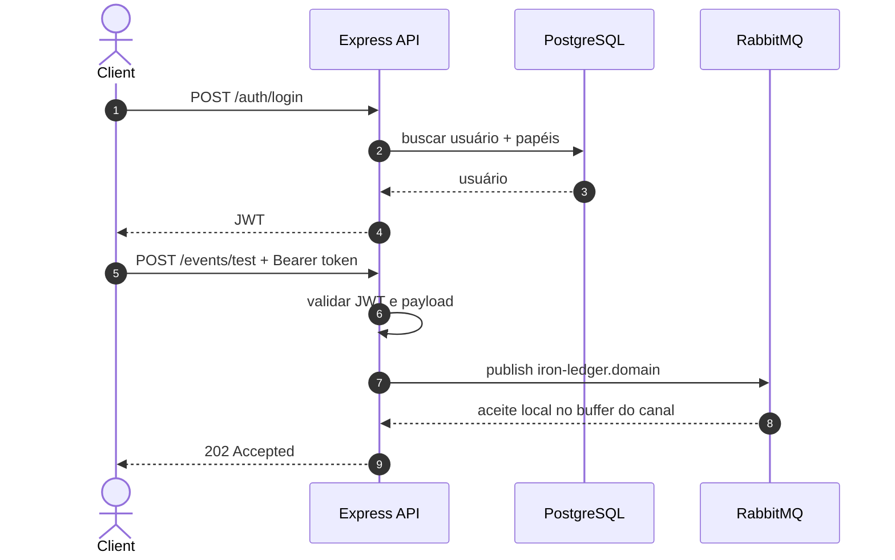
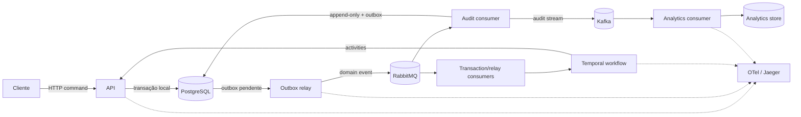
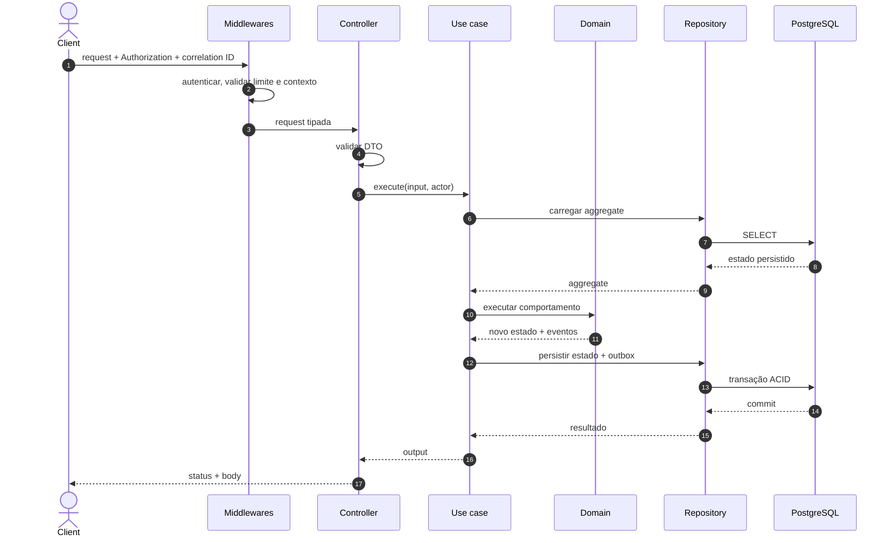
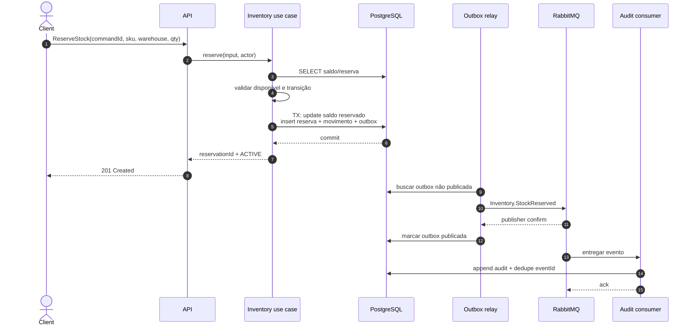
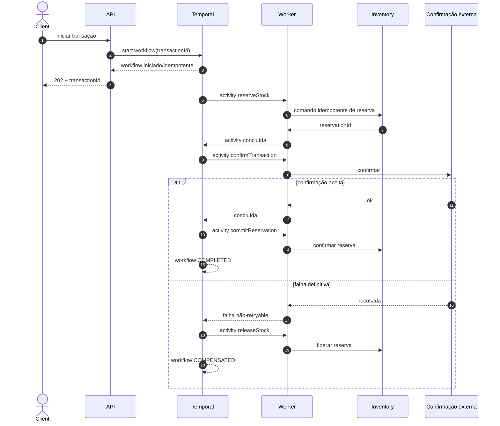
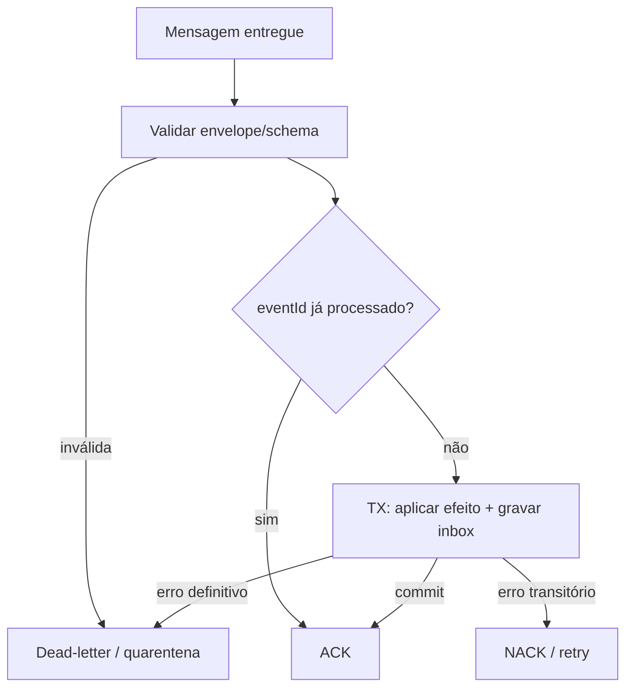
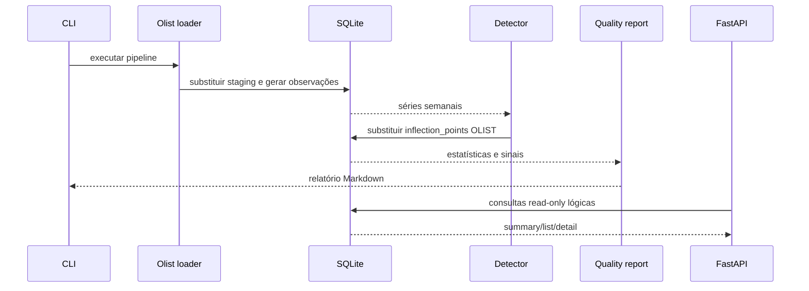
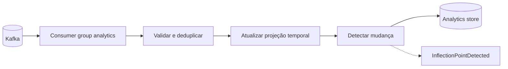

# Fluxo de eventos, comandos e consistência

Este documento mostra como uma requisição atravessa o `iron-ledger`, onde cada
decisão acontece e quais garantias devem existir quando o sistema evoluir para o
fluxo distribuído completo.

## 1. Visão executiva

O sistema usa quatro formas de coordenação, cada uma com semântica própria:

| Canal | Uso | Garantia pretendida |
| --- | --- | --- |
| HTTP | comandos e consultas do cliente | resposta síncrona |
| PostgreSQL | estado transacional da API | ACID local |
| RabbitMQ | eventos operacionais e distribuição de trabalho | entrega pelo menos uma vez |
| Kafka | stream durável para audit/analytics | retenção e replay |
| Temporal | processo longo e compensável | execução durável de workflow |

O princípio central é:

> Uma transação local protege invariantes locais. Eventos propagam fatos para
> outros contextos. Saga coordena efeitos que não podem ser um único commit.

## 2. Estado atual versus fluxo-alvo

### Executável hoje



Esse endpoint prova conectividade e formato básico. O cliente atual não usa
publisher confirms, portanto o retorno não comprova persistência pelo broker. O
endpoint também não altera Inventory, não grava Audit, não publica em Kafka e
não inicia workflow Temporal.

### Arquitetura-alvo



Outbox e consumers ainda não estão implementados, mas são necessários para
transformar o desenho em um fluxo confiável.

## 3. Vocabulário de mensagens

### Command

Expressa intenção: `ReserveStock`, `ReleaseStock`, `StartTransaction`. Pode ser
recusado e normalmente tem um destinatário responsável. Use imperativo.

### Domain event

Expressa fato ocorrido: `StockReserved`, `TransactionCompleted`. Não pode ser
“desocorrido”; efeitos podem ser compensados por fatos posteriores. Use passado.

### Integration event

É a representação pública e estável de um fato para outros contextos. Pode ser
derivada de um evento interno, removendo detalhes e estabilizando o contrato.

### Query

Pede informação sem intenção de mudar estado. Query não publica evento de
domínio e deve ser tratada como idempotente.

## 4. Envelope de evento recomendado

```ts
type EventEnvelope<TName extends string, TPayload> = {
  eventId: string;
  eventName: TName;
  eventVersion: number;
  occurredAt: string;
  producer: string;
  aggregateId?: string;
  correlationId: string;
  causationId?: string;
  actorId?: string;
  traceparent?: string;
  payload: TPayload;
};
```

### Semântica dos campos

| Campo | Finalidade |
| --- | --- |
| `eventId` | deduplicação da ocorrência |
| `eventName` | roteamento e significado estável |
| `eventVersion` | evolução incompatível do schema/semântica |
| `occurredAt` | instante do fato no produtor |
| `producer` | origem operacional |
| `aggregateId` | entidade/aggregate principal afetado |
| `correlationId` | une toda a operação distribuída |
| `causationId` | mensagem/comando que causou este evento |
| `actorId` | usuário ou sistema responsável |
| `traceparent` | continuação do trace distribuído |
| `payload` | dados específicos do evento |

Nunca inclua senha, hash de senha, JWT, secret, connection string ou dados
pessoais desnecessários. Evento tende a ser replicado e retido por mais tempo
que a request original.

## 5. Convenções de nomes e roteamento

Convenção do contrato:

```text
<Context>.<AggregateOuAssunto><Fato>

Inventory.StockReserved
Inventory.StockReleased
Transaction.TransactionStarted
Transaction.TransactionCompleted
Audit.RecordCreated
Analytics.InflectionPointDetected
```

O cliente RabbitMQ atual converte camel case para routing key minúscula, por
exemplo `Inventory.StockUpdated` → `inventory.stock.updated`.

Recomendação de topologia RabbitMQ:

```text
exchange: iron-ledger.domain (topic, durable)

queue: audit.domain-events
binding: #

queue: transaction.inventory-events
binding: inventory.stock.*

queue: kafka-relay.audit-events
binding: audit.#
```

Cada consumidor lógico deve possuir sua própria fila. Compartilhar a mesma fila
entre Audit e Analytics faria as mensagens competirem, não serem copiadas.

## 6. Fluxo HTTP comum



Responsabilidades:

- middleware trata aspectos transversais;
- controller traduz HTTP e valida forma do payload;
- use case coordena a intenção;
- domínio protege invariantes;
- repository traduz modelo para persistência;
- commit inclui estado e outbox, nunca publicação externa direta.

## 7. Fluxo de autenticação implementado

1. `POST /auth/login` recebe e-mail e senha.
2. Zod valida e-mail e tamanho mínimo da senha.
3. `LoginUseCase` normaliza o e-mail.
4. `PrismaLoginUserRepository` busca usuário e papéis.
5. bcrypt compara a senha com `passwordHash`.
6. status e `deletedAt` são verificados.
7. JWT é assinado com subject igual ao ID do usuário e issuer fixo.
8. chamadas protegidas usam `Authorization: Bearer <token>`.
9. `jwtGuard` anexa `userId`, `email` e `roles` à request.

Falhas de credencial retornam 401; usuário inativo retorna 403; payload inválido
retorna 422. Erros inesperados são normalizados para 500 sem expor detalhes.

## 8. Fluxo de reserva de estoque — alvo



### Concorrência

Duas reservas simultâneas não podem consumir a mesma unidade disponível. Opções
aceitáveis:

- `SELECT ... FOR UPDATE` dentro de transação curta;
- optimistic locking usando `StockLevel.version`;
- `UPDATE ... WHERE available >= quantity AND version = expected`.

O campo `version` já existe no schema e sugere optimistic locking. O caso de uso
deve verificar número de linhas atualizadas e repetir/retornar conflito de forma
controlada.

### Idempotência do comando

`commandId` ou `transactionId` deve possuir restrição única no efeito criado.
Responder a um retry com a reserva existente é diferente de criar outra reserva.
Idempotência não pode depender apenas da memória da instância da API.

## 9. Fluxo de saga — alvo



### Workflow versus activity

Workflow contém decisão e sequência determinística. Activity contém I/O. Nunca
abra conexão Prisma, faça HTTP ou publique mensagem diretamente no workflow.

### Retry

Classifique erros:

- **técnico transitório**: timeout, conexão, 503 → retry com backoff;
- **negócio definitivo**: estoque insuficiente, item inativo → não retryable;
- **estado desconhecido**: timeout após envio externo → consultar por chave
  idempotente antes de repetir.

Timeouts devem ser finitos. Retry sem limite e sem observabilidade transforma
incidente em workflow eternamente bloqueado.

### Compensação não é rollback

Liberar uma reserva cria um novo fato que neutraliza o anterior. O histórico de
`StockReserved` continua verdadeiro. A compensação pode falhar e precisa de
retry, alerta e operação manual documentada.

## 10. Outbox transacional

### Problema do dual write

Isto é incorreto:

```text
1. COMMIT no PostgreSQL
2. publish no RabbitMQ
```

Se o processo morrer entre 1 e 2, o estado mudou sem evento. Inverter a ordem
permite evento publicado para uma transação posteriormente revertida.

### Solução

Na mesma transação SQL da mudança, inserir uma linha em `outbox_events`. Um
relay independente publica linhas pendentes e marca o resultado depois do
publisher confirm.

Campos mínimos:

```text
id, event_name, event_version, aggregate_id, payload,
correlation_id, occurred_at, published_at, attempts, last_error
```

O relay pode publicar novamente se cair depois do broker aceitar e antes de
marcar `published_at`. Portanto o consumidor continua obrigado a deduplicar.

Estado atual: **PLANEJADO**. O `RabbitMqClient.publish` é direto e serve ao
endpoint de teste, não oferece atomicidade com o PostgreSQL.

## 11. Inbox e consumidores idempotentes

Modelo de consumo recomendado:



A tabela inbox pode conter `consumer`, `event_id`, `processed_at` e resultado.
Restrição única `(consumer, event_id)` impede duplicação. A gravação da inbox e
o efeito local devem compartilhar a mesma transação quando usam o mesmo banco.

## 12. RabbitMQ e Kafka: responsabilidades distintas

### RabbitMQ

Adequado para distribuição operacional, filas por consumidor, routing keys,
ack/nack e dead-letter. A unidade de retenção é a fila e mensagens confirmadas
são removidas.

### Kafka

Adequado para log ordenado por partição, retenção por tempo/tamanho, replay e
múltiplos consumer groups. Consumir não remove o registro do tópico.

### Ponte pretendida

O fluxo descrito no projeto prevê eventos de domínio em RabbitMQ, Audit
persistindo append-only e uma publicação auditável/reprocessável em Kafka para
Analytics. Essa ponte precisa de outbox própria; não deve ser um publish extra
no mesmo handler sem garantia.

Sugestão inicial de tópicos:

```text
iron-ledger.audit.v1
iron-ledger.inventory.v1
iron-ledger.analytics-signals.v1
```

Escolha de chave:

- `aggregateId` preserva ordem por aggregate;
- `transactionId` preserva ordem da saga;
- não use chave aleatória quando ordem relativa for requisito.

## 13. Fluxo de Audit — alvo

1. recebe um integration event;
2. valida versão e envelope;
3. verifica inbox por `eventId`;
4. remove/redige campos proibidos;
5. persiste registro append-only;
6. grava outbox para Kafka na mesma transação;
7. confirma mensagem RabbitMQ;
8. relay publica em Kafka;
9. marca outbox publicada.

Audit deve manter dois tempos: `occurredAt` do fato e `recordedAt` da recepção.
Diferença alta entre ambos é sinal operacional de backlog ou relógio incorreto.

## 14. Fluxo de Analytics

### Batch implementado



O SQLite usa WAL e IDs determinísticos derivados da chave natural do sinal. O
reprocessamento apaga e recria resultados `OLIST`, mantendo resultado lógico
estável para a mesma entrada.

### Streaming planejado



Migrar de batch para stream exige definir janela, watermark, evento atrasado,
reprocessamento, checkpoint e correção de resultados. Não basta preencher o
arquivo `kafka_consumer.py`.

## 15. Garantias reais

Não há “exactly once” ponta a ponta apenas por escolher um broker. A garantia
prática é:

| Trecho | Garantia |
| --- | --- |
| estado + outbox no mesmo PostgreSQL | atomicidade local |
| relay → broker | pelo menos uma vez |
| broker → consumidor | pelo menos uma vez |
| efeito + inbox local | efeito lógico uma vez por consumidor |
| workflow Temporal | histórico durável + activities potencialmente repetidas |

O objetivo é **effectively once** por idempotência, chaves únicas e transações
locais.

## 16. Ordenação

Ordem global raramente é viável ou necessária. Defina o escopo:

- RabbitMQ: ordem pode ser quebrada por múltiplos consumers, retries e
  redelivery;
- Kafka: ordem existe apenas dentro de uma partição;
- Temporal: histórico do workflow é ordenado para aquele workflow;
- PostgreSQL: `createdAt` sozinho não desempata eventos simultâneos.

Quando a ordem por aggregate for necessária, use `aggregateId` como chave e
inclua `aggregateVersion`. Consumidor pode rejeitar, estacionar ou reconstruir
quando observar lacuna de versão.

## 17. Falhas e comportamento esperado

| Falha | Resultado esperado |
| --- | --- |
| PostgreSQL indisponível | comando falha; nenhum evento deve ser publicado |
| RabbitMQ indisponível | estado/outbox persistem; relay tenta depois |
| consumidor cai antes do ACK | broker entrega novamente; inbox deduplica |
| mensagem inválida | quarentena/DLQ com motivo, sem loop infinito |
| Kafka indisponível | outbox de Audit acumula e alerta por backlog |
| activity Temporal expira | retry conforme política e idempotência |
| compensação falha | workflow permanece visível e alerta operação |
| Analytics parado | operação principal continua; lag aumenta |
| Jaeger parado | negócio continua; telemetria degrada sem bloquear request |

Dependência observacional ou analítica não deve ficar no caminho crítico de uma
mutação operacional.

## 18. Dead-letter e retry

Uma política mínima deve definir:

- número máximo de tentativas;
- backoff e jitter;
- erros retryable versus definitivos;
- exchange/fila de dead-letter;
- metadados de tentativa e último erro;
- alerta e procedimento de replay;
- retenção da mensagem original.

Replay não é “reenviar tudo”. Antes de reprocessar, corrija a causa, preserve o
`eventId` original e confirme que o consumidor continua idempotente.

## 19. Observabilidade e correlação

Toda entrada deve obter ou criar `correlationId`. O valor atravessa:

```text
HTTP header → log → use case → outbox → broker headers/envelope
→ consumer log → Temporal workflow/search attributes → activity → evento seguinte
```

Campos de log recomendados:

```json
{
  "level": "info",
  "service": "iron-ledger-api",
  "operation": "inventory.reserve-stock",
  "correlationId": "...",
  "causationId": "...",
  "eventId": "...",
  "aggregateId": "...",
  "actorId": "...",
  "durationMs": 42,
  "outcome": "success"
}
```

Não registre payload completo por padrão. Logs são dados e precisam de política
de acesso, retenção e redação.

Métricas essenciais:

- latência e erro por endpoint/caso de uso;
- conexões e queries lentas do PostgreSQL;
- profundidade e idade da fila RabbitMQ;
- outbox pendente mais antiga e taxa de publicação;
- lag de consumer Kafka;
- workflows por status e activities em retry;
- quantidade/idade de mensagens em DLQ;
- tempo entre `occurredAt` e `recordedAt` em Audit.

## 20. Segurança no fluxo

- autenticação na borda não substitui autorização no caso de uso;
- broker e banco não devem usar credenciais padrão fora do local;
- TLS deve proteger conexões externas e entre redes não confiáveis;
- eventos devem aplicar minimização de dados;
- consumidores validam schema mesmo em rede interna;
- JWT nunca deve ser propagado como payload de evento;
- `actorId` é contexto de auditoria, não credencial delegada;
- endpoint `/events/test` deve ser removido ou desabilitado em produção.

## 21. Evolução de contratos

Mudança aditiva normalmente compatível:

- adicionar campo opcional;
- adicionar novo tipo de evento;
- ampliar enum somente se consumidores tolerarem valor desconhecido.

Mudança incompatível:

- remover/renomear campo;
- mudar unidade ou significado;
- tornar opcional obrigatório;
- reutilizar nome de evento para outro fato.

Para quebra semântica, publique nova versão. Produtores devem permitir uma
janela de migração; consumidores desconhecidos não devem derrubar a fila inteira.
Schemas runtime (Zod, JSON Schema ou equivalente) são recomendados além dos tipos
TypeScript, pois mensagens chegam como bytes não confiáveis.

## 22. Testes por camada

| Escopo | O que provar |
| --- | --- |
| domínio unitário | invariantes e transições sem I/O |
| caso de uso | coordenação, erro e eventos com portas fake |
| repository integration | SQL, locks, constraints e transações reais |
| contract | produtor e consumidor concordam com schema/versionamento |
| consumer integration | dedupe, retry, ack/nack e DLQ |
| workflow | sequência, retry e compensação com Temporal test environment |
| end-to-end | request → persistência → evento → projeção |
| chaos/failure | queda entre commit/publish/ack e recuperação correta |

Cenário obrigatório para qualquer consumidor: entregar o mesmo `eventId` duas
vezes e comprovar que o efeito de negócio ocorre apenas uma.

## 23. Checklist para implementar um evento

1. Nomeie um fato de domínio no passado.
2. Defina dono, aggregate e consumidores conhecidos.
3. Crie payload mínimo e versionado em `shared-types`.
4. Adicione validação runtime.
5. Gere `eventId`, correlação e causalidade.
6. Persista estado e outbox na mesma transação.
7. Configure exchange/topic, binding/key e retenção.
8. Implemente consumer com inbox/idempotência.
9. Classifique retries e configure DLQ.
10. Adicione métricas, logs e trace context.
11. Teste duplicação, indisponibilidade e replay.
12. Documente dados sensíveis e política de retenção.

## 24. Sequência recomendada de implementação

Para chegar ao desenho sem criar infraestrutura ociosa ou integrações frágeis:

1. implementar regras e repositório de Inventory;
2. adicionar idempotência e concorrência no saldo;
3. criar tabela/relay de outbox e contratos runtime;
4. implementar Audit com inbox append-only;
5. ligar Audit ao Kafka com segunda outbox;
6. implementar Transaction e worker Temporal;
7. integrar Analytics ao stream mantendo o batch reproduzível;
8. ativar logger estruturado, propagação de correlação e OpenTelemetry;
9. implementar Web consumindo APIs estáveis.

## 25. Mapa para investigação de incidentes

Ao receber um `correlationId`:

1. localize a request e seu resultado nos logs da API;
2. confirme commit do aggregate, movimento e outbox;
3. verifique `publishedAt`, tentativas e erro da outbox;
4. procure `eventId` na fila/DLQ e inbox do consumidor;
5. consulte registro append-only de Audit;
6. se houver saga, abra o workflow pelo `transactionId` na Temporal UI;
7. verifique offset/lag no Kafka;
8. confirme a projeção no Analytics;
9. compare `occurredAt`, `recordedAt` e timestamps de processamento.

Sem correlação consistente, investigação distribuída vira inferência por horário.
Por isso correlação é requisito funcional de operabilidade, não detalhe de log.
