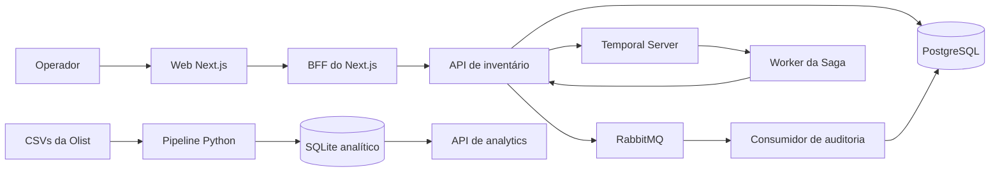

# Roteiro de gravação do Iron Ledger

Este documento é um guia para **preparar, ensaiar e gravar** um vídeo de aproximadamente **7 a 8 minutos**. A história central é acompanhar uma operação de estoque desde a interface até a auditoria. Depois, o vídeo mostra uma Saga real no Temporal e encerra com o laboratório de analytics da Olist.

> **Resumo da proposta:** uma mudança de estoque precisa ser segura, rastreável e compreensível. Mostre primeiro o efeito na tela, depois o mecanismo que o produziu.

## 1. O que o público deve entender ao final

Ao terminar o vídeo, quem assiste deve conseguir responder:

1. **O que o projeto resolve?** Controle de estoque com reservas, movimentações e histórico de auditoria.
2. **O que funciona na aplicação?** Login, leitura de estoque, criação de movimentação e consulta ao log pela web; Saga de reserva, confirmação e compensação pela API e pelo Temporal.
3. **Como as partes se comunicam?** Next.js/BFF chama a API; PostgreSQL guarda o estado; RabbitMQ leva eventos à auditoria; Temporal coordena a Saga. Analytics é um serviço Python separado que consulta dados históricos da Olist em SQLite.
4. **Qual é o limite da demonstração?** A tela `/transactions` ainda usa dados demonstrativos; a Saga real aparece na API e na Temporal UI. Analytics não consome em tempo real os eventos de estoque apresentados no vídeo.

**Duração sugerida:** 7min30s. Se o limite for menor, use a versão de 3 minutos da seção 9. Se quiser mostrar código com calma, use a extensão da seção 10.

## 2. Mapa visual para a explicação de arquitetura

Exiba este desenho por 15 a 25 segundos durante a introdução técnica ou no fechamento. Ele também ajuda a orientar a ordem das abas da gravação.



Há **dois caminhos operacionais** no vídeo. A movimentação criada na web atualiza o estoque e gera auditoria. A Saga, iniciada pela API, reserva uma quantidade e depois confirma a baixa ou libera a reserva quando ocorre a falha simulada. O laboratório analítico é um terceiro assunto, apresentado separadamente.

## 3. O que foi verificado e o que deve ser conferido no dia

Em **02/10/2026**, `pnpm dev` iniciou API e web; PostgreSQL, RabbitMQ e Temporal responderam; o login e as rotas BFF de estoque e auditoria funcionaram. O analytics respondeu com base processada. Foram executadas uma Saga de sucesso e uma de compensação: no sucesso, houve baixa de uma unidade e registro de auditoria; na compensação, a quantidade e a reserva voltaram aos valores anteriores. `pnpm check` passou com **7 testes** e os builds de API, worker e web.

Esse resultado é um **registro de ensaio**, não a garantia de que os processos estarão abertos em uma gravação futura. Confira novamente a tabela abaixo antes de iniciar a captura. Os números de estoque e de eventos mudam após cada ensaio; use os valores que aparecerem na tela naquele momento.

| Serviço | URL/porta nesta configuração local | O que precisa acontecer |
| --- | --- | --- |
| Web | `http://localhost:3001/login` | Página de login abre; após entrar, estoque carrega sem faixa de fallback. |
| API | `http://localhost:3002/health` | Resposta JSON com `status: "ok"`. |
| PostgreSQL | `localhost:5432` | API consegue autenticar e listar os itens. |
| RabbitMQ | `localhost:5672`; painel `http://localhost:15672` | API inicia e o log recebe eventos após uma operação. |
| Temporal | `localhost:7233`; UI `http://localhost:8088` | Worker fica em estado `RUNNING` e workflows aparecem na UI. |
| Analytics | `http://localhost:8000/health`; documentação em `/docs` | `health=ok` e `/analytics/summary` apresenta dados. |

As portas são lidas do `.env` da raiz. O arquivo local usado no ensaio configurava API em `3002` e web em `3001`; altere os comandos deste roteiro se o seu `.env` tiver outras portas. **`pnpm dev` inicia apenas API e web.** Worker e analytics usam comandos próprios.

## 4. Preparação do ambiente, antes de apertar “Gravar”

### 4.1. Preparar a máquina

1. Abra o Docker Desktop e espere `docker info` responder. Se houver outro PostgreSQL local usando `5432`, encerre-o pelo gerenciador em que ele foi iniciado ou ajuste `POSTGRES_PORT` e `DATABASE_URL` para a mesma porta alternativa. No ensaio, um PostgreSQL diferente na porta `5432` causou erro `P1000` de credenciais.
2. Na raiz do repositório, confirme que as dependências estão instaladas. Em instalação nova, execute `pnpm install`. O projeto declara pnpm na propriedade `packageManager` de `package.json`; consulte a versão atual ali, pois ela pode mudar.
3. Confira a existência de `.env` na raiz. Se não existir, copie `.env.example` e configure as URLs e credenciais locais. **Não mostre o `.env` na gravação.**
4. Se o analytics fizer parte do vídeo, prepare o Python 3.11+ e execute `npm run setup:python` em uma instalação nova. Confira os CSVs Olist em `services/analytics/data/raw/` e a base `services/analytics/data/processed/analytics.db`. Se a base ainda não existir, execute o pipeline indicado em [`analytics/olist-first-step.md`](analytics/olist-first-step.md) antes de iniciar a API Python. `pnpm dev:analytics` apenas serve a base já processada.
5. Confira se `SEED_ADMIN_EMAIL` e `SEED_ADMIN_PASSWORD` no `.env` correspondem ao usuário criado pelo seed: o worker usa essas credenciais para chamar a API durante a Saga. Não exiba esses valores na gravação.

### 4.2. Abrir os serviços em ordem

Use terminais separados. Deixe os terminais da aplicação e do worker abertos durante a gravação.

```powershell
# Terminal de infraestrutura: inicia só o necessário para a web e a Saga.
pnpm infra:core
docker compose --profile platform up -d temporal temporal-ui
docker compose ps
```

**Com o PostgreSQL saudável**, prepare o banco antes de iniciar a API. Em banco novo, execute os três comandos abaixo. Em banco já preparado, execute `pnpm db:deploy` se houver migração pendente. O seed redefine os saldos demonstrativos; rode-o antes de escolher o SKU da gravação.

```powershell
pnpm db:generate
pnpm db:deploy
pnpm db:seed
```

```powershell
# Terminal da aplicação: inicia API e web.
pnpm dev
```

```powershell
# Terminal da Saga: inicia o worker que executa as atividades.
pnpm dev:worker
```

```powershell
# Terminal do analytics, se essa parte entrar no vídeo.
pnpm dev:analytics
```

Se os serviços já estiverem abertos, confirme as URLs antes de iniciar uma segunda instância. Uma segunda web na porta `3001` causa `EADDRINUSE`. `pnpm infra:up` sobe também a API em contêiner; para a gravação com API local via `pnpm dev`, use os serviços explícitos mostrados acima e evite disputar a porta da API.

### 4.3. Fazer um ensaio funcional de cinco minutos

Faça esta checagem **antes da captura**:

- Entre pela web com o usuário do seed. Não deixe a senha aparecer no vídeo; faça o login antes de ligar a gravação ou corte esse trecho na edição.
- Abra **Estoque**. Aguarde a mensagem de carregamento sair. Se aparecer a faixa **“Dados de demonstração”**, a consulta real falhou; não use essa tela para afirmar que o banco está respondendo.
- Abra **Log de Auditoria**. Também não deve aparecer a faixa de fallback. Eventos anteriores podem estar presentes: o log não precisa começar vazio.
- Escolha um SKU com estoque disponível e anote **SKU, depósito, disponível e reservado**. Use esse mesmo item na cena de movimentação. Para a Saga, escolha um item com pelo menos 2 disponíveis, caso queira fazer sucesso e falha simulada no mesmo SKU.
- Faça uma movimentação pequena de ensaio ou use a que já foi testada no ambiente; confirme atualização do disponível, histórico e auditoria. Depois escolha uma **nova referência** para a tomada final, por exemplo `VIDEO-20261002-01`.
- Abra `http://localhost:8088` e confira que o worker iniciado por `pnpm dev:worker` mostra estado `RUNNING` no terminal. Teste uma Saga seguindo [`temporal/saga-demo.md`](temporal/saga-demo.md) antes de depender dela na gravação.
- Confira `http://localhost:8000/analytics/summary`. Se o resumo estiver vazio, execute o pipeline conforme [`analytics/olist-first-step.md`](analytics/olist-first-step.md) antes da gravação.

**Critério de início:** API e web respondem; login, estoque e auditoria usam dados reais; você sabe qual SKU vai mostrar; a referência da tomada final está preparada; uma Saga de ensaio termina em `COMPLETED` ou `COMPENSATED` se o Temporal fizer parte do vídeo; `/analytics/summary` retorna observações se o analytics fizer parte do vídeo. A página inicial da Temporal UI e a mensagem de início do worker, isoladamente, não comprovam que as atividades conseguem autenticar e terminar.

### 4.4. Preparar a tela para evitar interrupções

- Deixe abertas, nesta ordem, as abas **Estoque**, **Log de Auditoria**, **Temporal UI** e **Analytics `/docs` ou `/analytics/summary`**. No fim, volte à aba de estoque para comparar o saldo.
- Ajuste o zoom do navegador para que SKU, disponível e reservado caibam juntos. Feche notificações pessoais e abas sem relação com o projeto.
- Prepare o terminal dos comandos da Saga com as variáveis `$headers` e `$item` **antes** da captura, conforme o guia da Saga. Não grave o retorno do login nem mostre o token.
- Tenha o desenho da seção 2 aberto em uma imagem ou no preview Markdown. Use-o como uma cena curta, sem tentar explicar cada caixa em detalhe.
- Grave uma tomada curta de teste de voz e tela. Confirme que o cursor, os nomes das abas e o texto do log ficam legíveis no arquivo gravado.

## 5. Roteiro principal — aproximadamente 7min30s

Os tempos são referências. Faça pausas breves após uma atualização de saldo, antes de trocar de aba e ao apontar um registro de auditoria. A fala abaixo pode ser lida quase literalmente; ajuste apenas o nome do produto e os números que estiverem na sua tela.

### Cena 1 — 0:00 a 0:35: problema e promessa

**Tela:** página inicial ou título do projeto. Passe rapidamente pelo menu, sem abrir cada seção.

**Fala sugerida:** “Este é o Iron Ledger, um projeto de controle de estoque e auditoria. Quando alguém altera o estoque, preciso saber qual item foi afetado, quanto mudou e ter um registro para investigar depois. Vou mostrar essa operação funcionando e, em seguida, como o sistema lida com uma transação que pode falhar.”

**Transição:** clique em **Estoque**. Não gaste o começo do vídeo listando todas as tecnologias; a necessidade do produto vem primeiro.

### Cena 2 — 0:35 a 1:25: leitura do estoque real

**Tela:** `/inventory`. Busque o SKU ensaiado e deixe uma linha bem visível. Aponte nome, depósito, disponível, reservado e status.

**Ação:** diga em voz alta o número **disponível antes da operação**. Anote esse número fora da tela para conferir depois. Se houver mais de um depósito, use o filtro para que a linha correta fique isolada.

**Fala sugerida:** “Cada linha representa o saldo de um produto em um depósito. O valor disponível leva em conta o que já está reservado. Isso importa porque uma saída não pode consumir a parte comprometida por outra operação. Estou vendo esses dados pela API, através do BFF do Next.js.”

**Resultado visível esperado:** a faixa “Dados de demonstração” não aparece e o botão **Novo movimento** está habilitado.

### Cena 3 — 1:25 a 2:25: criar a movimentação

**Tela:** modal **Novo movimento** e, depois, a linha do SKU.

**Ação:** selecione o mesmo produto e depósito, escolha **Entrada**, informe quantidade **1** e a referência preparada, por exemplo `VIDEO-20261002-01`. Clique em **Registrar** uma vez; espere o modal fechar e a lista atualizar. Uma entrada simples permite comparar claramente o disponível antes e depois.

**Fala sugerida:** “Vou registrar a entrada de uma unidade e colocar uma referência que eu consiga procurar depois. A API valida a operação e grava a mudança de saldo junto com o movimento no PostgreSQL. Agora o disponível aumentou em uma unidade.”

**Resultado visível esperado:** o disponível aumenta em **1**. Se a tela demorar, pare de falar por um instante e espere o carregamento terminar; não clique repetidamente em **Registrar**.

### Cena 4 — 2:25 a 3:05: histórico e auditoria

**Tela:** expanda o SKU para mostrar o histórico; em seguida, abra **Log de Auditoria**.

**Ação:** encontre a movimentação pela referência e pelo horário. Na auditoria, localize a entrada de atualização do inventário e abra seus detalhes. Se ela não estiver no primeiro carregamento, atualize a página após alguns segundos; o consumidor recebe o evento de forma assíncrona.

**Fala sugerida:** “O histórico operacional mostra a entrada que acabei de fazer. Depois do registro no banco, a API publica um evento no RabbitMQ. O consumidor grava a auditoria, que permite investigar o evento e relacioná-lo à operação. Há um pequeno intervalo entre a ação e a chegada do evento ao log.”

**Detalhe importante:** a atualização de saldo e o registro do movimento são atômicos no PostgreSQL. A publicação no RabbitMQ ocorre **depois** dessa transação; não diga que banco e broker participam de uma única transação distribuída.

### Cena 5 — 3:05 a 3:35: explicar o desenho da arquitetura

**Tela:** desenho da seção 2. Aponte apenas o caminho Web → API → PostgreSQL → RabbitMQ → Auditoria.

**Fala sugerida:** “A web concentra a operação para o usuário. O BFF encaminha a chamada autenticada à API. As regras de inventário são aplicadas no backend; o PostgreSQL guarda o saldo e o movimento. O RabbitMQ leva o evento ao consumidor que alimenta o log de auditoria.”

**Transição:** “Para uma operação que tem mais de uma etapa, eu uso o Temporal.”

### Cena 6 — 3:35 a 4:45: Saga bem-sucedida

**Tela:** terminal com o comando já preparado, depois Temporal UI. Mostre o ID do workflow e suas atividades. Volte ao estoque ou faça uma consulta curta à API para mostrar a baixa.

**Ação:** inicie `POST /transactions` com `failConfirmation: false`, quantidade **1** e um item que tenha disponível. Consulte `GET /transactions/:id` até obter `status: "COMPLETED"` e `result.status: "COMPLETED"`. Na Temporal UI, abra o workflow correspondente pelo ID; mostre a reserva e a confirmação. A confirmação cria um movimento `OUTBOUND` e diminui o estoque em uma unidade.

**Fala sugerida:** “Aqui a operação tem etapas. O Temporal inicia a Saga, o worker reserva uma unidade pela API e, após a confirmação, a API consome a reserva e registra a saída. O workflow guarda a sequência executada. Vou comparar o saldo: a quantidade disponível caiu uma unidade, e a reserva temporária já foi encerrada.”

**Comandos para a tomada:** prepare `$headers` e `$item` antes, seguindo o guia da Saga. Durante a gravação, mostre apenas o início e a consulta, sem imprimir o token:

```powershell
$body = @{ stockLevelId = $item.stockLevelId; quantity = 1; failConfirmation = $false } | ConvertTo-Json
$started = Invoke-RestMethod -Method Post -Uri http://localhost:3002/transactions -Headers $headers -ContentType 'application/json' -Body $body
$started | Select-Object workflowId, status
Invoke-RestMethod -Uri "http://localhost:3002/transactions/$($started.workflowId)" -Headers $headers
```

Se a última consulta ainda mostrar `RUNNING`, aguarde e repita **somente o GET**. Não envie outro POST, pois isso abriria outra Saga.

### Cena 7 — 4:45 a 5:45: falha simulada e compensação

**Tela:** mesmo terminal e Temporal UI. Mostre o resultado `COMPENSATED` e a sequência de atividades; termine com o saldo do item.

**Ação:** anote quantidade e reservado antes. Inicie outra Saga com `failConfirmation: true` e quantidade **1**. Consulte até obter `result.status: "COMPENSATED"`. A execução do workflow no Temporal pode ter estado técnico `COMPLETED`, pois o tratamento da falha terminou com sucesso; o **resultado de negócio** é `COMPENSATED`. Compare o saldo: a quantidade física não diminui e a reserva retorna ao valor anterior.

**Fala sugerida:** “Agora simulo uma falha na confirmação. A reserva chegou a ser feita, mas o worker executou a compensação e a liberou. O resultado de negócio é ‘compensado’: não houve baixa definitiva e o disponível voltou ao valor anterior. Essa falha é intencional para demonstrar o mecanismo, não representa um serviço externo real falhando neste momento.”

```powershell
$body = @{ stockLevelId = $item.stockLevelId; quantity = 1; failConfirmation = $true } | ConvertTo-Json
$started = Invoke-RestMethod -Method Post -Uri http://localhost:3002/transactions -Headers $headers -ContentType 'application/json' -Body $body
Invoke-RestMethod -Uri "http://localhost:3002/transactions/$($started.workflowId)" -Headers $headers
```

**Cuidado na explicação:** não abra `/transactions` esperando ver essa Saga; a tela atual dessa rota ainda usa dados demonstrativos. Use a API e a Temporal UI para a prova visual.

### Cena 8 — 5:45 a 6:40: laboratório de analytics

**Tela:** `http://localhost:8000/docs` ou a resposta de `/analytics/summary`, seguida de uma consulta a `/analytics/inflection-points?limit=5`.

**Ação:** mostre o número de observações e de pontos detectados que aparecer **na sua execução**, abra um ponto e indique a métrica e a explicação. Não memorize contagens: um novo processamento pode alterá-las. Se for importante mostrar o relatório de qualidade, abra `services/analytics/reports/olist-data-quality.md` por poucos segundos.

**Fala sugerida:** “O analytics é um serviço Python separado. Ele processa dados históricos públicos da Olist, organiza observações por vendedor, categoria e semana e identifica mudanças persistentes em métricas. A API permite consultar esses sinais e suas evidências. Este laboratório usa dados históricos próprios; ele ainda não recebe, em tempo real, os eventos de estoque que mostrei antes.”

**Limite da afirmação:** os sinais são observacionais. Não chame o resultado de ruptura física de estoque comprovada nem de previsão com IA em produção.

### Cena 9 — 6:40 a 7:20: conclusão e maturidade do projeto

**Tela:** desenho de arquitetura ou retorno ao estoque e ao registro de auditoria. Finalize com uma tela estável, sem terminal rolando.

**Fala sugerida:** “O fluxo demonstrado começa na operação de estoque, preserva o histórico e torna a mudança auditável. Para etapas longas, o Temporal coordena reserva, confirmação e compensação. O analytics amplia o projeto com uma análise histórica independente. Os próximos passos são ligar a interface de transações à Saga, criar credenciais próprias para o worker e reforçar a entrega dos eventos entre banco e broker.”

**Última imagem:** nome Iron Ledger, uma frase curta sobre o problema resolvido e, se fizer sentido para a apresentação, o link do repositório.

## 6. Quadro de apoio para a narração

| Pergunta que pode surgir | Resposta curta e correta |
| --- | --- |
| “`pnpm dev` sobe tudo?” | “Ele sobe API e web. PostgreSQL, RabbitMQ e Temporal são infraestrutura à parte; worker e analytics têm comandos próprios.” |
| “O número do dashboard vem da API?” | “Esta demonstração comprova integração de estoque e auditoria. Outras telas ainda contêm dados de apresentação.” |
| “A auditoria é instantânea?” | “Ela é assíncrona: o consumidor recebe o evento do RabbitMQ após a operação.” |
| “A Saga aparece na tela de transações?” | “A Saga real está na API e na Temporal UI; a página web de transações ainda não foi integrada.” |
| “A falha foi real?” | “A falha na confirmação foi simulada por parâmetro para exercitar a compensação real da reserva.” |
| “Analytics analisa essa movimentação?” | “Ainda não. Ele processa o conjunto histórico da Olist em um pipeline separado.” |

## 7. Se alguma cena falhar durante a gravação

**Web exibe “Dados de demonstração”.** Pare a tomada e verifique API `/health`, sessão de login e `API_URL`. O fallback mantém a interface visível, mas não prova integração. Grave novamente quando a faixa desaparecer.

**`EADDRINUSE` em `3001` ou `3002`.** Há outro processo nessa porta. Teste as URLs; se for a instância correta, use-a. Para reiniciar, encerre o terminal que a iniciou. Não abra outro `pnpm dev` sobre os mesmos processos.

**API falha com `P1000`.** O PostgreSQL em `5432` rejeitou as credenciais do `.env`. Confirme se o Docker PostgreSQL correto está ativo e se não há outro PostgreSQL local ocupando a porta.

**Movimento apareceu, auditoria não.** Aguarde alguns segundos e atualize `/audit-log`; confira RabbitMQ e o terminal da API. A página busca a lista ao carregar, então uma atualização pode ser necessária.

**Saga continua `RUNNING`.** Confira Temporal Server, worker e terminal de atividades. Consulte o mesmo `workflowId` novamente. Evite iniciar outra transação só porque a primeira ainda não terminou.

**Analytics responde, mas não há pontos.** Verifique a base SQLite e execute o pipeline descrito em [`analytics/olist-first-step.md`](analytics/olist-first-step.md). Uma resposta de saúde sozinha não prova que o pipeline foi processado.

**A gravação perdeu uma cena.** Retome a partir de um ponto de corte natural: após a movimentação, antes da auditoria; após a arquitetura, antes da Saga; ou antes do analytics. Diga os números observados naquela tomada, não os valores de um ensaio anterior.

## 8. Critério final para publicar o vídeo

Assista ao arquivo exportado uma vez sem pausar e confirme:

- O usuário entende o problema nos primeiros 30 segundos.
- A movimentação mostra **antes → ação → depois** no mesmo SKU.
- O log exibido corresponde à operação e não está em fallback.
- O caso de sucesso da Saga mostra reserva e confirmação; o de falha mostra compensação e saldo preservado.
- A fala diferencia analytics histórico de eventos operacionais ao vivo.
- Senhas, token JWT e conteúdo do `.env` não aparecem.
- Toda afirmação sobre dados reais corresponde a uma tela ou resposta de API mostrada no vídeo.

## 9. Versão curta de 3 minutos

Se o tempo for rígido, grave apenas o fluxo mais forte:

1. **0:00–0:25:** problema e objetivo do Iron Ledger.
2. **0:25–1:05:** estoque real, disponível e reservado do SKU escolhido.
3. **1:05–1:50:** entrada de 1 unidade e comparação do disponível antes/depois.
4. **1:50–2:25:** histórico e log de auditoria do mesmo evento.
5. **2:25–3:00:** desenho resumido da arquitetura e uma frase sobre a Saga e o analytics como extensões já operacionais em serviços separados.

Nesse corte curto, não tente mostrar Temporal e analytics em detalhe: cada um exige tempo para que a evidência seja compreensível.

## 10. Extensão para 10 minutos, se houver tempo

Após a cena 7, mostre por cerca de 1 minuto cada:

- Em `apps/api/src/modules/inventory/domain/entities/stock-level.entity.ts`, a regra que calcula disponível e impede uma baixa abaixo do reservado.
- Em `apps/temporal-worker/src/workflows/transaction-saga.workflow.ts`, a sequência de reserva, confirmação e compensação. Relacione cada chamada às atividades vistas na Temporal UI.
- No relatório de qualidade do analytics, uma limitação concreta dos dados Olist e por que os sinais não provam causalidade.

Use trechos curtos do código, com fonte ampliada. A explicação deve ligar a linha mostrada ao efeito já visto na tela.

## 11. Arquivos de referência

- [`temporal/saga-demo.md`](temporal/saga-demo.md): comandos completos para iniciar e consultar as duas execuções da Saga.
- [`analytics/olist-first-step.md`](analytics/olist-first-step.md): CSVs, pipeline, metodologia e API do laboratório Olist.
- `package.json` e `scripts/dev/run-app.mjs`: comandos de desenvolvimento.
- `apps/api/src/main.ts`: conexão inicial com PostgreSQL e RabbitMQ e início do consumidor.
- `apps/api/src/modules/inventory/infra/repositories/prisma-inventory.repository.ts`: persistência de saldo, movimento e reserva.
- `apps/web/src/features/(operations)/inventory/ui/InventoryPage.tsx` e `apps/web/src/features/(governance)/audit-log/ui/AuditLogPage.tsx`: telas usadas na demonstração principal.
